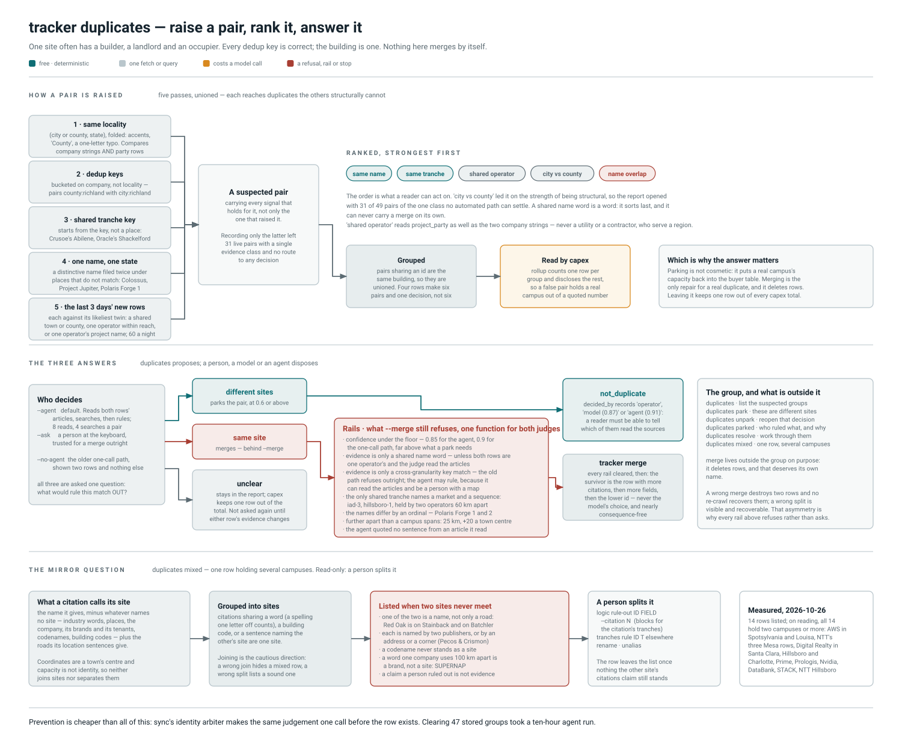

# `tracker duplicates` and its subcommands

> Rows that look like one campus stored several times.

One site often has a builder, a landlord and an occupier, and whichever name a
source picks becomes its own row with its own dedup key. Every key is correct; the
building is one.

The opposite happens too: one row holding several campuses' citations, because a
company built more than one in the same town or county. `duplicates mixed` lists
those — see [One row, several campuses](#one-row-several-campuses-duplicates-mixed).

Bare `tracker duplicates`, `duplicates parked` and `duplicates mixed` are
**read-only**. `park`, `unpark` and `resolve` write and take the single-writer lock,
so per `CLAUDE.md` §2 they run on the production host.

## How a pair is raised

Four passes over the same rows, **unioned rather than substituted**, and a fifth for
the rows a night adds. Each reaches duplicates the others structurally cannot, and
the measurements are the argument:

| | Starts from | Reaches |
| --- | --- | --- |
| 1 | the `(city or county, state)` bucket | the same-locality, different-company case that made `capex` need this at all. Finds 230 pairs live |
| 2 | dedup keys, bucketed on **company** — locality is the axis that disagrees | cross-granularity duplicates: Hyperion stored four times as `richland parish`, `holly ridge`, `richland`, `richmond parish`. Finds 259 pairs, but alone would **lose 225 of pass 1's 230** |
| 3 | a shared tranche key, not a place | a campus filed under two locality names that do not match — Stargate as Crusoe's `abilene` row and Oracle's `shackelford county` row. Nine pairs, seven of them real |
| 4 | one distinctive **name** in one state | a campus whose rows disagree about the place and share no tranche — xAI's Colossus as `Memphis` and as `孟菲斯`, TeraWulf's Lake Mariner under its county and under a town in it, Project Jupiter filed by two of its builders, CyrusOne Thad Hill as a town and as its county. The name must carry a word that is neither a place, nor industry vocabulary, nor the state: two operators' "Santa Clara Data Center" in Santa Clara name nothing |

| 5 | **one new row**, against every row in its state | the last three days' new campuses, each put to its likeliest twin once (`capex.twin_pairs`, `duplicates resolve --created-since`). A candidate shares a locality at either granularity — one row's town, the other's county — or sits within the distance rail, or is the **same operator** within that reach (Menlo Digital under Phoenix and under Ahwatukee), or, when neither row could be placed, the same operator naming the same project (Galaxy's Helios under "Afton", a town the Census file does not list, and under Dickens County). Evidence still comes from the same test the other passes use. On 2026-10-05 the new row "SoftBank / SB Energy — PORTS Technology Campus" in Piketon sat unpaired beside "SB Energy — PORTS-Pike Technology Campus" in Pike County: town against county, under two company names, so neither pass 1 nor pass 2 compared them |

**The nightly loop asks about every new row once.** After the discover crawl adds
campuses, the nightly loop (`tracker/overnight.py`) places them first (`ingest geo`: county and town
centre from the Census), then runs `duplicates resolve --merge --created-since` over
the last `TWIN_DAYS` (3) days, `--limit TWINS` (60) pairs at most, strongest evidence
first: one agent attempt per recent row that has a candidate, under the same rails
as every other pair, and a pair two new rows both point at is asked once. A row with
no candidate costs nothing — on 10-05 seven of the eight new rows had none, and the
eighth was the PORTS duplicate.

Each of those three changed after 2026-10-19, when 96 new rows left about 16 twins
standing. The pass ran *before* `ingest geo`, so a row fresh from an article had a
town and no county or coordinates, and a twin filed under the county shared nothing
it could see. It looked at tonight alone, so a night whose pass missed something
never looked again — the lookback re-asks only what changed, because a pair asked on
the same evidence is held back (`declines`). And it had no cap, so a 100-row night
could spend its budget here.

Pass 1's bucket is folded before anything is compared: accents, case and the words
that say what kind of place it is (`county`, `counties`, `parish`, `township`) are
dropped, and within one state two folded localities of five or more letters that
are one edit apart are one place. Stargate Michigan was stored six times, and the two
rows spelling Saline as "Salien" sat in their own bucket and were never compared
with the four that did not. The fold only decides which rows are *compared* — a pair
still needs a signal from the evidence below — so two different towns a letter apart
cost a comparison, not a pair. On a production copy passes 1 and 4 together raised
22 pairs never reported before, every one a real duplicate on inspection, and lost
none.

Every pass records **every** signal that holds for the pair, not only the one that
raised it. Pass 2 once recorded `shared_keys` and nothing else, which left 31 live
pairs carrying a single evidence class and no route to any decision — 12 of them
also shared a distinctive name token, 8 a real tranche key, and 6 were
byte-identical in name and company.

## The evidence classes, and why the order changed

`EVIDENCE_ORDER`, strongest first. They are not equal — a shared tranche is two
readings of one building, a shared operator is how one campus becomes four rows,
and a shared name word is a word.

| Class | Label | Carries a merge? |
| --- | --- | --- |
| `exact` | same name | yes |
| `tranche` | same tranche | yes, unless the key is a market sequence |
| `party` | shared operator | yes |
| `identity` | city vs county | only via the agent, never the one-call path |
| `name` | name overlap | only via the agent, and only between one operator's rows |

`identity` used to lead the list on the strength of being structural, so the report
opened with 31 of its 49 pairs — every one a class no automated path can settle.
The classes something can be *done* about now sort first.

`party` reads the company strings and the `project_party` rows — **never a utility
or a contractor**. Those serve a region: Dominion is a party on ten rows and Oncor
on seven, and on 2026-10-19 the twin pass offered AWS's Project Rainier and
Microsoft's La Porte campus, 50 km apart, on a shared utility alone. A shared tenant
still counts — Stargate filed under Crusoe and under Oracle, both naming OpenAI, is
the shape the signal was built for.

`name` carries a merge for a reading judge when both rows are **one operator's**
(`dedup.same_operator`: one key, or one a whole-word prefix of the other, "AMP Z"
and "AMP Z Champion Data Center Holdings LLC"). TeraWulf's Muskie filed under
Ashland and under Grayson, Galaxy's Helios under Afton and Dickens County: the same
company naming the same project is not a resemblance. Between two companies a shared
word is still only a word.

A shared word also had to get stricter. `Aligned Data Centers Phoenix` and
`NTT Global Data Centers Americas Phoenix` were reported as one campus on the token
"centers", because the generic list held the singular and not the plural. A tranche
key that turns up in more than one town is vocabulary, not identity, and no longer
pairs anything.

## Why the answer matters more than the report

`capex.rollup` reads the same suspected pairs and holds one row of every group out
of the buyer table, disclosed in the `*_skipped` fields. So a false pair does not
merely clutter a listing — **it takes a real campus's capacity out of a number
somebody quotes**, until a person rules it out. That is the whole reason parking
exists, and why a parked pair is *gone* from `suspected_duplicates` rather than
merely marked.

Pairs sharing an id are transitively the same building and are unioned into groups,
so four rows for one site are one decision rather than six.

## The subcommands

| | Writes | Does |
| --- | --- | --- |
| `duplicates` | no | lists the suspected groups. `--no-weak` drops the name-word-only pairs; `--parked` shows the ruled-out ones instead |
| `duplicates park A B …` | yes | records that these are different sites. Every pair among the ids is stored separately, so a third row appearing next week is still asked about |
| `duplicates unpark A B …` | yes | the exact inverse, including its shape |
| `duplicates parked` | no | every pair ruled out, with `decided_by` and the reason |
| `duplicates resolve` | yes | works through them with a model |
| `duplicates mixed` | no | the opposite question: rows whose citations describe more than one campus, with the citations that name each site and what they claim |

`tracker merge` lives **outside** the group on purpose: it deletes rows, and that
deserves its own name.

`park` and `unpark` take two or more ids because parking is a statement about a
*pair*; one id is refused. Nothing is edited or deleted either way.

## `duplicates resolve`

`duplicates` proposes and never disposes, which is right — a wrong merge destroys
two rows and no re-crawl recovers them. The cost of that caution was a report nobody
answered: 30 live pairs, 29 across genuinely different company names, each waiting
on a person to open two rows and read their citations.

### Which judge

All three ask **one question, in one wording**. `triage.CONTRADICTIONS` is the
checklist, and the agent judge, the one-call prompt file and
[`sync`'s identity arbiter](sync.md#the-identity-arbiter) all end in it; a test pins
the three copies together. It asks what would rule the match *out* rather than
whether the rows look alike, and permits `same` only when that search came back empty
and one tie can be quoted. Two data centre rows in one town always look alike, so
resemblance was never the question.

That framing is borrowed rather than invented — OpenSanctions Pairs (arXiv
2603.11051) measured it over 755,540 labelled pairs, taking an open 14B model from a
91.3% rule baseline to 98.2% F1. It is worth changing *here* because of what
`scripts/eval_pairs.py` found: of the pairs a judge has ruled `different` on the live
database, **24 of 38 have no rail that refuses them**. On that population the
rails contribute nothing and the wording of the question is the whole decision. See
[duplicate shapes](../duplicate-shapes.md).

Each judge also reports **what it checked** — `contradictions`, a short phrase per
check, either something it found or a check that came back clean. It is optional and
its absence changes no verdict, because the rails decide what may happen and this
only records the account. It travels into the park reason, so `duplicates parked`
answers "what was already ruled out" instead of only "different sites".

| Flag | Judge | Recorded as |
| --- | --- | --- |
| `--agent` (default) | reads both rows' articles, searches if it must, then rules | `agent (0.91)` |
| `--ask` at a terminal | a person, trusted for a merge without the confidence floor | `operator` |
| `--no-agent` | the older one-call path, shown two rows and nothing else | `model (0.87)` |

The agent reads at most eight articles and runs four searches a pair
(`agent.TOOL_LIMITS`), is told with two turns left to answer — `leave_alone` when it
cannot tell, which the declines ledger remembers — and retries a turn cut off
mid-reasoning with reasoning off. A tool-calling turn goes back with its reasoning,
which DeepSeek's thinking mode refuses the next turn without. Running out of steps used to throw the whole run
away, and a pair left that way was asked again next round.

`--ask` suppresses the agent: paying for a run whose answer is then overridden at
the keyboard buys nothing. `--no-llm` suppresses it too — the agent *is* a model, so
"no model" has to mean no model, or `--no-llm --no-ask` would spend calls instead of
saying that nothing can decide.

### Three answers, trusted unequally

* **different** parks the pair, with the evidence classes travelling in the reason.
  Reversible by `unpark`, and it is the useful half: it puts a real campus's
  capacity back into the buyer table. Both judges refuse a park under
  `MIN_CONFIDENCE` (0.6): releasing capacity into a published total on an answer
  the model itself rates a coin toss is not caution, and the agent path used to do
  exactly that.
* **same** merges, but only with `--merge` and only past every rail below.
* **unclear** leaves the pair in the report, which is a real answer.

**An undecided pair is not asked again on the same evidence.** Left alone, rated
below the floor, refused by a rail, or unable to quote a sentence — each is recorded
in `model_decline` with a hash of both rows' citations and of what paired them, and
the agent path holds the pair back **before** `--limit` is applied, so the limit buys
fresh questions. It comes back when either row's evidence changes or after
`declines.COOLDOWN_DAYS`; `--again` asks anyway. **Within one night it holds
whatever changed** (`declines.TONIGHT_HOURS`, 20 hours): rows gain citations all
evening — the Census lookup, a re-read — so on 2026-10-19 the hash moved between
rounds and Stargate Abilene's pair with its "Phase 2" twin was paid for three times. One
outcome is deliberately not recorded: "the same site, but merging needs `--merge`" — a
run with `--merge` must still reach that pair. A run that never reached an answer (a
provider failure) is recorded as `declines.ERROR` and held for the night only: it says
nothing about the pair, but asking again in the next round would pay to fail the same
way. Until 2026-10-29 it was not recorded at all. Nothing was recorded before
`declines`, and with 31 eligible pairs against a per-round limit of 25 every overnight
round re-paid for nearly the whole set at ~45,000-260,000 tokens a pair.

**The pass runs through the shared runner** (`tracker.judged.run`, the loop every paid
pass uses). A real run commits after every pair. It used to be one transaction for the
whole run, which held SQLite's write lock across every agent call — minutes at a time —
while a console sign-in waited five seconds and failed. A pair whose write raises is
rolled back and the run goes on, and the night's money is asked about before each wave
of pairs (`spend.ceiling_reached`, `TRACKER_SPEND_CEILING_CNY`): once spent, nothing new
starts, everything done is kept, and the command prints `spend ceiling reached`.

**The agent runs overlap** — up to `TRACKER_LLM_CONCURRENCY` at once, one for a local
model — in waves that never hold two pairs naming one row. A wave is formed only after
the previous one's merges are committed, and each pair's rows are read through the
run's `folded` map, so a pair whose row an earlier pair merged away waits for that merge
and is then asked about the row that holds it. The judge's evidence tools only read, so
each concurrent run reads through a session of its own (`triage.pair_investigate`);
the rails, the park and the merge stay on the main thread (`triage.pair_conclude`). A
`--dry-run` asks one pair at a time, because a session of its own could not see the dry
run's uncommitted merges.

### What `--merge` still refuses

Every branch is a rule stated elsewhere in the codebase, restated as a refusal the
run prints per pair. The poster lists all seven. **They are one function for both
judges** — `dupresolve.evidence_blocks_merge` — with a single flag for the one rail
the agent may pass. It was two hand-written copies until the agent's copy was found
to keep two of six: its docstring promised the market-sequence refusal and the code
never checked it, and with `--weak` a pair raised by nothing but a shared name word
could be folded. A rail is a fact about the pair, not about the judge, and two
copies of a fact are free to disagree. The two worth expanding:

* **A cross-granularity key match alone.** `dedup.py`'s founding invariant: a
  county-level row and a city-level row are never merged automatically, because no
  string comparison can tell whether "Racine County, WI" and "Mount Pleasant, WI"
  are one project. The **agent path drops this one**, and that is deliberate — a
  model shown two rows and nothing else is not a person with a map, but one that can
  read the articles and search can be, and 28 of 47 live groups are exactly this
  shape, with the model already reasoning containment unprompted. A market-sequence
  key beside the granularity match does not take that permission away: the key is
  struck from the hard evidence first, whoever is judging, and what is left is then
  weighed.
* **Ordinal siblings.** `Polaris Forge 1` in Ellendale and `Polaris Forge 2` in
  Harwood both hold `forge-2.polaris`, because one article listed the pair. Two real
  campuses, every signal in agreement, one digit between them.

Geography outranks the model in both paths: two rows further apart than one
campus spans are not one site whatever it concluded, because that is a fact check
rather than a menu. **What "apart" means depends on what the coordinates are.** Most
stored coordinates are a town's Census centre, not the site (`ingest geo` fills them
that way and says so), so `dupresolve.distance_limit` allows `FAR_APART_KM` (25 km)
plus `TOWN_CENTRE_KM` (20 km) for each row on a centroid: 65 km between two town
centres. On 2026-10-19 the flat 25 km refused four pairs the agent had judged one
campus at 0.88-0.95 — Crusoe's campus filed under Amarillo and under Claude is 44 km
of centroid from itself — and the judge had been told the distance was decisive.

### Which row survives

Not the model's choice. The row with more citations, then more fields filled, then
the lower id — deterministic, so the same input gives the same answer. It is also
nearly consequence-free: `merge_projects` recomputes every field from the combined
claims, so this decides a row number rather than a value. A citation both rows hold
is folded into the survivor's copy rather than dropped with the other, so the choice
decides a value only where two copies of one article disagree — the survivor's
stands and the other is named in its notes. A reader who pressed ☆ on the folded
row keeps following the campus: the watch moves to the survivor before the row is
deleted, rather than going with it. So do the decisions people and the nightly
review made about the folded row that live outside its citations: how its tranches
nest (`block_nesting`, migration 0042) and a role that has ended there — a former
tenant (`party_tenure`, migration 0044). Each is moved unless the survivor already
holds its own for the same tranche or party, which then stands.

`folded` carries a run's merges forward, so a later pair naming a row this run just
deleted is asked about the survivor instead. That is what settles a group of four
in one pass rather than one merge per run.

### Writability under `--dry-run`

`resolve --dry-run` still opens the database **writable** and still takes the write
lock, exactly as `tracker merge --dry-run` does. The run parks and merges inside a
transaction and the dry run is that transaction not being committed; a `mode=ro`
connection cannot even hold those writes long enough to describe them. The model
calls are paid for either way, which is the honest way to see what a run would do.

## Every name a campus goes by

Most twins are not a judgement problem at all: the company was spelled a second way,
or the row's key no longer described it, so an arriving article computed a key
nothing answered to. Two things close that before any pair is raised:

* **One company, one key.** `dedup.company_key` strips the industry's own trailing
  words ("Compass Datacenters", "EdgeCore Digital Infrastructure"), parentheticals
  ("Amazon (AWS)") and dotted initialisms ("Prologis, L.P."), and reads the operator
  roster's aliases — renames and acquisitions such as RagingWire → NTT and DuPont
  Fabros → Digital Realty, which only the coverage report used to read. On the
  2026-10-19 copy that took 286 spellings from 260 keys to 232. Since migration
  0043 every key is one record in the company registry (`tracker company`), and a
  spelling the rules miss can be folded by a person (`tracker company alias`): the
  key function reads a person's aliases last, on every connection, and the alias
  re-keys the rows it touches at once, the way a deploy that learned the spelling
  would. The parties the party signal compares are one per company too: a party
  named as a list of companies the registry knows is each of them, and two spellings
  of one company in one role on one campus are one party (`parties.split_names`,
  `same_company_names`). A joint venture's name is **not** filed under its first
  partner by rule: measured on the 10-22 copy, that would have given "EdgeConneX and
  TA Realty" the key of EdgeConneX's own Atlanta row, a pair already ruled two
  campuses, and sent the venture's articles there.
* **Every row reachable by the key it would be filed under today.** `dedup_key` is
  written once and never rewritten, so `tracker.keys` records a row's *current*
  natural key in `project_alias` when it differs — a town learned since, a spelling
  the rules learned since — on every write, on `tracker init` and on every
  `backfill derive`. A merge records the folded row's natural key too, and the
  identity arbiter's routings are remembered the same way, so the next article
  spelled that way goes straight to the row instead of paying for another check.
  On the 10-19 copy 134 rows gained such a key. A key another row holds outright is
  never taken from it: two rows sharing a natural key is a pair for the passes above.
* **A wrong fold can be undone for the next reading.** A merge's key keeps routing
  every later article about the folded campus to the survivor, so a fold that was
  wrong stays wrong. `tracker unalias KEY --why` removes that one routing and notes
  it on the survivor; the next reading creates the campus as its own row, and
  `duplicates park` keeps the passes from folding it again. The folded citations
  stay where they are. First used on 2026-10-22 for Related Digital's 1 GW South
  Works data center, folded into the Illinois quantum park on the same land.

## Prevention beats all of it

A duplicate created at ingest costs, in order: a row nobody wanted; one side of the
pair held out of every `capex` total until somebody settles it; then either a person
reading two sets of citations or a merge that deletes a row and cannot be undone.
Measured here: 47 suspected groups holding 22,012 MW twice, and clearing most of
them took a ten-hour agent run.

The same judgement made *before* the insert costs one call and deletes nothing —
that is [`sync`'s identity arbiter](sync.md#the-identity-arbiter). It now rules from
the article extraction already read, rather than fetching it again, and is handed the
suspected row's full details so it answers the same question `resolve` asks here, one
call earlier and with nothing yet to undo.

## One row, several campuses: `duplicates mixed`

The mirror of everything above. A row's identity is one company in one place —
`dedup_key` is `company|locality|STATE` — so where a company builds several campuses
in one county or one town, every article about any of them is filed on the same row,
and its capacity, dates and phase become a mixture nobody chose. On the 2026-10-26
production snapshot AWS's #158 in Spotsylvania County, named for the Carter's Store
Tech Campus, also cited the Cosner, Orrock and Crossroads campuses; each of NTT's
three Mesa rows mixed the Elliot Road campus, open since 2022, with the land at Pecos
and Crismon roads bought in 2025 for a campus due in 2028.

`duplicates mixed` lists those rows with their sites, the citations that name each
site, and what those citations claim. It is **read-only**: splitting is a person's
call, made with the tools below, and nothing here writes. The nightly morning report
prints its first two lines — how many rows, and the one with the most sites — under
`tracker duplicates`'s.

### What a citation's site is

Every citation keeps the name it gave the site (`claims.name`) and the sentences
behind its claims (`quotes`). Its site is what is left of that name once everything
that names no particular site is taken out, plus the roads its location sentences
(the quotes behind its name, city, county and state) put it on.

| Taken out | Why |
| --- | --- |
| industry words, stages, sizes and ordinals | "Digital Infrastructure Campus", "AI-Ready", "High Performance Computing Center" say what kind of site, not which. Each raised a false site on the snapshot |
| every locality the database knows in the state, and the state | every Ashburn campus is called Ashburn something |
| the company, its spellings and initials; rostered operators and end users; parties named at two or more places | "Anthropic-Amazon New Carlisle" says who, not where |
| a word one company uses at two campuses 100 km apart (`BRAND_KM`) or in two states | SUPERNAP is Las Vegas and Reno; Fairwater is Wisconsin and Atlanta |
| building codes — `PH1`, `DFW-02`, `IAD 327` — and capitals with no digit | one campus holds many buildings: NTT's VA1 to VA7 in Ashburn. A code still joins the citations that share it |
| codenames, "Project X" | how a site is known before it has a public name. Six false sites on the snapshot were a codename beside a public name: Helios, Matador, Excalibur, Morgan, Llano, Potomac Promise |
| a landmark after "former" or "near" | the "Former Sears HQ" is 3333 Beverly Road |

A party named for the one site it holds stays: "Pacific Proving LLC" sold NTT the land
at Pecos and Crismon roads, and taking party names out of site names took the site's
own name with it.

### Which citations are one site

Citations are joined when they share a word (a spelling one letter off counts —
"Camelia" is "Camellia", "Bridgefeld" is "Bridgefield"), share a building code, or
one's location sentence names the other's site. **Joining is the cautious
direction**: a wrong join hides a mixed row, a wrong split lists a sound one. Fermi's
Matador articles say it is "officially named" the Donald J. Trump Advanced Energy and
Intelligence Campus, and that sentence keeps the two names one campus. A landform is
not a name for this purpose: a sentence about water discharged "into Sedges Creek" does
not name AWS's Northeast Creek campus.

### When two sites are listed

Two sites that never meet are listed only when

* **one of them is a name, not only a road.** A campus has several sides: DataBank's
  Red Oak campus is "along Stainback Road" in one article and at "3080 Batchler Rd."
  in another;
* **each is named by two publishers, or by an address or a street corner.** One
  article's nickname — RagingWire's "The Bolt", Aligned's "Deer Valley" — is not a
  second campus; a directory's page for "NTT Global Data Centers Mesa Campus (Pecos &
  Crismon)" is.

Three signals were measured and left out. **Coordinates**: every stored point is the
town's Census centre, one per row, so two campuses in one town share it. **Capacity**:
one campus's buildings are quoted at different sizes, and Prime's two Santa Clara
buildings are 9 MW each, so a figure neither joins sites nor separates them. **Towns
inside a county row**: 15 county rows had citations naming two towns, and 13 were one
campus seen from its town and from the next one.

### Measured

On the 2026-10-26 snapshot (954 rows, 7,648 citations) the report lists 14 rows, and
read by hand every one holds two campuses or more: AWS in Spotsylvania and Louisa
counties, NTT's three Mesa rows, Digital Realty in Santa Clara, Hillsboro and
Charlotte, Prime in Santa Clara, Prologis and Nvidia in San Jose, DataBank in Atlanta,
and STACK and NTT in Hillsboro. A first draft that compared name words alone listed 34
rows, about 20 of them one campus under two names; each rule above is one of those
shapes. Recall is what that precision cost. A row is missed when its second campus is
named by one publisher only — STACK's Phoenix row holds one article about its Avondale
Techplex campus — or when the two names meet: xAI's Memphis row holds Colossus on Paul
R. Lowry Road and Colossus 2 on Tulane Road, but the names share their word once the
ordinal is dropped, and one article names both roads in a sentence.

### What a person does

Keep one campus on the row and take the other's claims off it:

* `tracker logic rule-out ID FIELD --citation N --why …` takes one citation's claim
  about one field out of the merge; `blocks` as the field takes its tranches off the
  row.
* `tracker tranches rule ID TRANCHE elsewhere --by NAME` moves a single tranche out.
* `tracker rename ID NAME --why …` when the row is named for the campus it gives up.
* `tracker unalias KEY --why …` when a merge's key routes the other campus's articles
  here.

The report reads those rulings. A claim decided against is not evidence, and a
citation none of whose claims still stands — every figure, date and phase, and its
tranches — is left out, so a row leaves the list as it is repaired. A row that is one
campus after all leaves it the same way: rule the odd name out (`tracker logic
rule-out ID name --citation N`). Nothing here creates the other campus's row; a
reading filed under another key, or `tracker ingest manual`, does.

## Source map

Touching any of these means the poster is in scope. Re-render with
`python scripts/render_workflow_diagrams.py duplicates`.

| Concern | Where |
| --- | --- |
| The four detection passes | `tracker/capex.py` — `suspected_duplicates`, `_pair_evidence`, `_locality_buckets`, `_locality_word`, `_one_edit_apart` |
| A new row against its likeliest twin | `tracker/capex.py` — `twin_pairs`, `_place_words`; `tracker/triage.py` — `resolve_pairs(pairs=)`; `tracker/cli/duplicates.py` — `duplicates_resolve(--created-since, --limit)`; `tracker/overnight.py` — `Night.run_round` (`twin_since`), `TWIN_DAYS`, `TWINS`, `ingest geo` before the pass |
| The party signal, and the guard on it | `tracker/parties.py` — `shared_across_companies`, `_identifying_keys`, `_NOT_IDENTIFYING_ROLES`, `keys_for` |
| One company, one key | `tracker/dedup.py` — `company_key`, `_company_slug`, `_reduce`, `_alias_table`, `_COMPANY_SUFFIXES`, `_COMPANY_ALIASES`, `same_operator`, `use_person_aliases`, `alias_listeners`; `tracker/seed/operators.toml` — `aliases`; `tracker/companies.py` — `add_alias`, `load_aliases`, `sync`; `tracker/db.py` — `_read_company_aliases`; migration `0043_company`; `tracker/parties.py` — `split_names`, `same_company_names`, `_folded`, `known_keys` |
| Every key a row answers to | `tracker/keys.py` — `sync`, `remember`, `natural_key`, `renormalise`; `tracker/upsert.py` — `upsert_record` (end); `tracker/merge.py` — `merge_projects`; `tracker/derive.py` — `run`; `tracker/cli/quality.py` — `init` |
| Evidence classes, labels, ranking | `tracker/capex.py` — `EVIDENCE_ORDER`, `EVIDENCE_LABELS`, `strongest_evidence`, `DuplicatePair.rank` |
| Grouping and the MW figure | `tracker/capex.py` — `duplicate_groups`, `double_counted_mw` |
| Key comparison primitives | `tracker/dedup.py` — `all_keys`, `is_cross_granularity_match`, `is_market_sequence`, `sibling_ordinals`, `exact_identity`, `shared_parties_across_companies` |
| Parking | `tracker/pairs.py` — `park`, `unpark`, `listing`, `parked_keys`, `canonical` |
| The rails, shared by both judges | `tracker/dupresolve.py` — `evidence_blocks_merge`, `merge_blocked`, `MIN_CONFIDENCE`, `MERGE_CONFIDENCE`, `FAR_APART_KM`, `TOWN_CENTRE_KM`, `distance_limit`, `on_town_centre`, `centroid_ids` |
| The one-call path | `tracker/dupresolve.py` — `resolve`, `resolve_one`, `survivor`, `ask_model`, `pair_label`, `_checked` |
| Scoring a change to any of it | `scripts/eval_pairs.py`; `docs/duplicate-shapes.md` |
| The question all three judges are asked | `tracker/triage.py` — `CONTRADICTIONS`, `PAIR_SYSTEM`, `PAIR_SYSTEM_BASE`; `tracker/prompts/duplicates-resolve-v3.txt` |
| The agent path | `tracker/triage.py` — `settle_pairs`, `resolve_pairs`, `pair_triage`, `pair_prepare`, `pair_investigate`, `pair_conclude`, `pair_verdict_tools`, `_checked`, `pair_subject`, `pair_evidence` |
| One loop for every paid pass: per-pair commit, failures, waves, the money ceiling | `tracker/judged.py` — `run`, `waves`, `Done`; `tracker/spend.py` — `ceiling_reached`; `tracker/cli/_shared.py` — `_workers`, `_print_held`, `_print_ceiling` |
| What one agent run may spend | `tracker/agent.py` — `run`, `TOOL_LIMITS`, `WRAP_UP_TURNS`; `tracker/llm.py` — `without_thinking` |
| Not asking the same pair twice | `tracker/declines.py` — `split`, `pick`, `record`, `holds`, `citations`, `COOLDOWN_DAYS`, `TONIGHT_HOURS`, `ERROR`; migration `0025_model_decline` |
| The merge itself | `tracker/merge.py` — `merge_projects`, `_move_events`, `_move_risks`, `_move_nesting`, `_move_tenure`; `tracker/upsert.py` — `fold_source`; `tracker/watchlist.py` — `repoint` |
| Prevention at write time | `tracker/gatekeeper.py` — `same_site_arbiter`, `_warm_verdict`, `_cold_verdict`, `_rejection`, `RULES`; `tracker/ingest/crawl.py` — `ExtractionContext` |
| One row, several campuses | `tracker/mixed.py` — `mixed_rows`, `_Lexicon.build`, `_Row.read`, `_Row.words`, `_group`, `_names_the_other`, `_disagree`, `_stated`, `_ruled_out`, `_carries_anything`, `_NOT_A_SITE`, `_LANDFORMS`, `_CODE`, `_CODENAME`, `_LANDMARK`, `BRAND_KM`; `tracker/overnight.py` — `Night.morning_report` |
| CLI, printers, keyboard prompt | `tracker/cli/duplicates.py` — `merge`, `unalias`, `duplicates`, `duplicates_park`, `duplicates_unpark`, `duplicates_resolve`, `duplicates_parked`, `duplicates_mixed`, `_print_parked`, `_dupe_prompt` |
