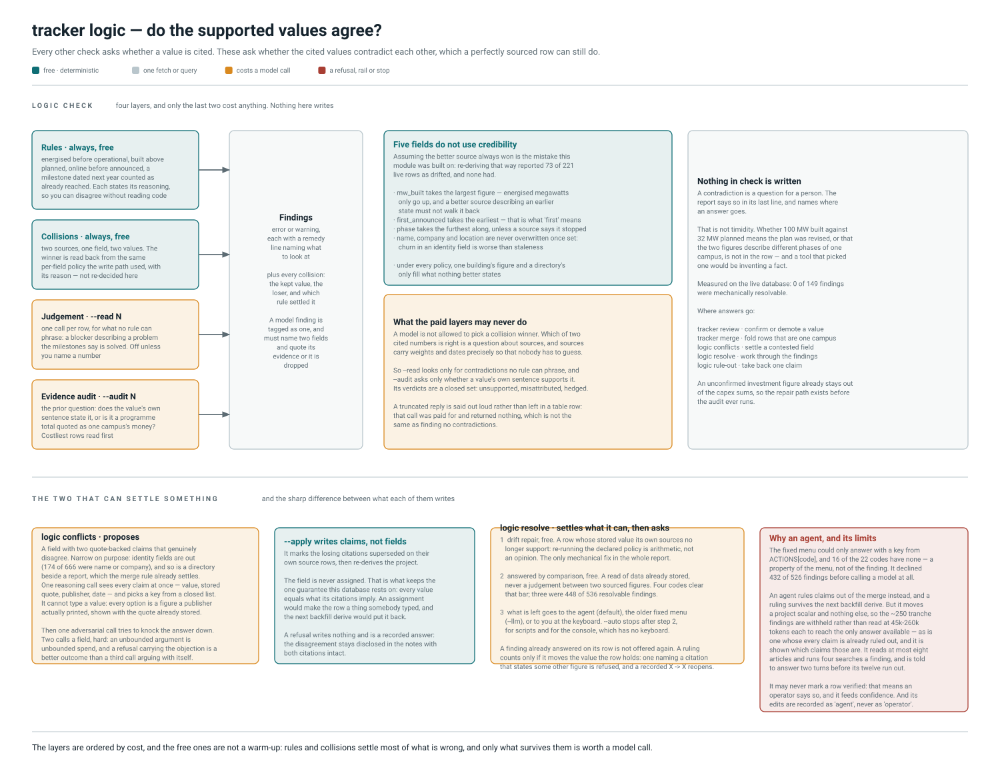

# `tracker logic` and its subcommands

> Find values that contradict each other, and settle the ones that can be.

Every other check in this project asks whether a value is *supported*. These ask
whether the supported values *agree*: a row can be perfectly cited and still be
impossible. A campus marked `operational` whose construction track has reached
nothing is either the wrong phase or a missing milestone, and both citations behind
it can be sound.

`logic check` never writes and runs anywhere. `logic conflicts` writes only with
`--apply`; `logic resolve` writes on every path except a non-interactive run with
no flags. Per `CLAUDE.md` §2, the writing forms run on the production host.



## `logic check` — four layers, and only the last two cost anything

| Layer | Flag | Cost | What it catches |
| --- | --- | --- | --- |
| Rules | always | free | deterministic contradictions computable from the row, its milestones and its obstacles |
| Collisions | `--collisions`, on | free | two sources claiming different values for one field |
| Judgement | `--read N` | one call per row | what no rule can phrase — a blocker describing a problem the milestones say is solved |
| Evidence audit | `--audit N` | one call per row | whether a value's own recorded sentence actually states it |

`--read` and `--audit` both default to 0, and `read_limit=None` means **none**, not
unlimited. That distinction is load-bearing: `None` meant unlimited once, and the
first `--audit`-only run silently started reading every row in the database.

### Rules are free and must stay that way

Paying an LLM to notice that `mw_built > mw_planned` is paying for arithmetic, and
a rule states its reasoning in a way anybody can check without reading code.
Twenty-two codes are in circulation and **only 6 carry an action** — the rest name
something only a person can settle, or a contradiction between a phase enum and a
campus that is two things at once.

Nine of those sixteen sit in `ACTIONS` as a deliberate empty tuple with a comment
saying why. The other seven are not in the table at all and reach the same answer
through `.get`'s default. The behaviour is identical; the record is not. An empty
entry is a decision somebody wrote down, a missing one is a rule added without
anybody asking the question — and one of the seven, `value_above_its_evidence`, is
worth asking about, because a claim does exist there and is too low.

**A date is overdue when the period it names is over, not when it starts.**
"The second half of 2026" is stored as 2026-07-01 and "2026" as 2026-01-01, so
`past_its_own_date` compared with the stored day called both late the morning they
began, and its one action clears the date. On 2026-10-13 the resolver cleared two
correct dates that way. The rule now reads `expected_online_precision` and waits for
the end of the month, quarter, half or year (`delays.period_end`); a date on the first
of a month with no recorded precision is read as the month, or on 1 January as the
year, because the wider reading only delays a warning and the narrower one deletes a
value. On the production copy that day it took 5 of 13 findings off the list.

**A campus that is late is the same campus on the console and here.** The client
asked for a campus whose expected date has passed, with no news of it going live, to
be flagged on the console as a *suspected delay*. `past_its_own_date` was already
that question, asked only here, so it now comes from the one function the console,
the export and the API read (`delays.assess`) and the two cannot disagree about a
campus. Three things changed in what it asks:

* **News of going live counts wherever it is recorded.** Running capacity
  (`mw_built`), a running tranche, or an energisation dated on or after the expected
  date — not a forecast — each settle it. Before, only the phase did: on a
  production copy on 2026-10-20, five of the eleven findings had one of these, among
  them Novva's North Las Vegas campus with 100 of its 100 MW running.
* **It is asked whether or not a tranche is late too.** It used to give way to
  `block_past_its_own_date`, so a campus whose only dated tranche slipped, with
  nothing running and nothing still to come, was reported as a tranche and never as
  a campus — sixteen campuses on that copy, against eleven reported. The tranche
  finding still names which tranche. A tranche still to come still explains a passed
  campus date, which was the first phase's; a paused or cancelled one dated ahead
  does not, and nor does the utility's plant filed as a tranche.
* **Its sentence no longer counts days.** A finding the agent could not settle is
  held back on a hash of the question it was shown, and "412 days ago" made that a
  new question every midnight, re-asked at full price.

On that copy the campus findings went from 11 to 22, the same 22 the console flags.

`block_past_its_own_date` reads each tranche with the same rule
(`delays.tranche_state`) as the console's amber "was due": the period has to be
over, and a tranche that is running, has an energisation date, or was paused or
cancelled is not late. A tranche records no precision, so its date is read the way
an unrecorded project date is. It used to compare the stored day, so a tranche dated
"2026" was late on 2 January, and the page kept its own copy of the test that
disagreed with it both ways — the page flagged paused and cancelled tranches, this
flagged ones with an energisation date. On that copy the change took the tranche
findings from 116 to 93.

### Collisions report the policy's answer; they do not re-decide it

The winner is read back from `upsert.resolve_field` — the same function the write
path used — and printed with its reason. Assuming that reason is always "the better
source won" is the mistake this module was built on: re-deriving winners that way
reported 73 of 221 live rows as having drifted from their sources, and none of them
had. A tool that invents 73 faults is worse than one that finds none.

**Five fields do not use credibility**, by declared policy:

* `mw_built` takes the **largest** figure — energised megawatts only go up, and a
  better source describing an earlier state should not walk it back.
* `first_announced` takes the **earliest**, because that is what "first" means.
* `phase` takes the **furthest along**, unless a source says it stopped.
* `name`, `company` and the location fields are **never overwritten** once set:
  churn in an identity field is worse than staleness.

And the facts a reader sums never keep a value **no live claim states**
(`upsert.CLAIM_OWNED_FIELDS`). With every claim ruled out, or none left after a
re-extraction, the field resolves empty — the tranche and party reconciles may
refill it from their own citations — and the clearing is recorded as a rule's
decision. The merge used to hand back whatever the row held, which is how $487B of
investment came to stand on rows where nothing claimed it.

### What the paid layers may never do

A model is not allowed to pick a collision winner. Which of two cited numbers is
right is a question about sources, and sources carry weights and dates precisely so
that nobody has to guess. Every judgement finding must name two fields and quote
its evidence or it is dropped, and nothing it says is written to the database.

Audit verdicts are a closed set: `unsupported`, `misattributed`, `hedged`. Rows are
read **costliest first** — the audit exists to protect the sums, so the dollars at
stake pick the reading order rather than the row id — and rows with no quoted
values are skipped outright, because a call that could only come back empty is not
worth paying for.

A truncated reply is said out loud rather than left in a table row: that call was
paid for and returned nothing, which is **not** the same as finding no
contradictions.

## `logic conflicts` — proposes

One to two reasoning calls per contested field. This is the one path where a model
compares two contradicting sentences.

**Why it exists.** Every other value in this database was extracted from one
article in isolation, and disagreements between articles are then settled by a sort:
quote-backed first, then source weight, then date. That is the right default and it
cannot tell a superseded figure from a rival one. Hyperion (#10) held Meta's 2024
$10B over its 2026 $50B because both come from the same publisher at the same
weight, and crawl order decided it.

**What counts as a dispute** — five filters, each removing a case a model cannot
help with:

* quote-backed claims only; an unconfirmed claim already loses by rule;
* a directory, wiki or digest beside a first-hand report loses by rule too, and so
  does one building's figure beside the whole site's, so neither contest reaches a
  model;
* genuinely different values, by `confidence.values_conflict` — the same tolerance
  the row's own conflict disclosures use;
* tracked fields only; `notes` is assembled and `blocker` is derived from risk rows;
* **never an identity field.** "Hyperion" against "Richland Parish Data Center" is
  two names for one campus, and ruling against a claim would not even move the
  value. Measured: 174 of 666 contested fields were `name` or `company`.

44 claims on one investment figure group down to 5 distinct values, which is what
the model sees — each with its stored quote, publisher and date. **It cannot type a
value:** the options are figures publishers actually printed, so a fabricated
sentence has nowhere to enter by this path.

Then one **adversarial** call tries to knock the answer down. Two calls a field,
hard: the flowchart this came from has a "go round again" arrow with no limit on
it, and an unbounded argument is unbounded spend. An error in the second call lets
the answer stand rather than refusing it — the pick already cleared the confidence
floor on evidence a person can read, and discarding it because a request timed out
would make the outcome depend on the network.

**Refusing is a first-class answer.** Two credible publishers stating two figures
with nothing to separate them is not a coin toss. A refusal writes nothing, and the
disagreement stays disclosed in the row's notes with both citations intact.

### What `--apply` writes is not the field

It marks the losing claims `superseded` on their own source rows and re-derives the
project. The field is never assigned, and that keeps the one guarantee this database
rests on: **every value equals what its citations imply.** An assignment would make
the row a thing somebody typed, and the next `backfill derive` would put it back.

`source.fields` is deliberately left alone — that column means "a verbatim quote
supports this", and a superseded value still has one. The article really did say
$10 billion, and it was right in 2024. It simply stops deciding the merge.

`superseded` and `misread` are separate reasons for the same mechanism, and the
difference matters to a reader: `superseded` says the figure was right when written
and has since been restated, a fact about the world; `misread` says the sentence was
always about something else, a fact about the sentence. The first could stop
applying; the second cannot.

Run `tracker backfill dates` first — the tiebreak and the model both reason from
publication dates. A run of more than 20 fields asks for `--yes`, and writes are
committed per field so a run that dies partway keeps what it settled.

## `logic resolve` — settles what it can, then asks

Three stages before anything is put to a model:

1. **Drift repair, free.** A row whose stored value its own sources no longer
   support. This is the *only* contradiction in the whole report a machine may
   settle, and it is worth being precise about why: it is not a judgement about
   which claim is true — that was decided by the declared per-field policy — but the
   narrower observation that the row no longer matches the answer that policy gives,
   which happens after a hand edit or when a source is attached by a path that did
   not recompute. Re-running the policy is arithmetic.

   "The answer that policy gives" includes what happens after the merge. For
   `phase`, a *named* building further along raises the campus
   (`blocks.phase_after_blocks`), so a row whose claims say `construction` and whose
   serving TX-1 hall says `operational` has not drifted. Compared against the claims
   alone, 48 such rows were reported and "repaired" every night, and every
   recompute raised them straight back. An unnamed tranche ("Phase 1") no longer
   lifts a campus: no block status carries a quote, and on Switch's The Rock two
   unnamed "serving" phases — a neighbour's finished building, from a city page
   listing several operators — made it read `operational` over four quotes saying
   `announced`. The check and the recompute call the same function, so they cannot
   disagree about it.

   The same holds for capacity. A row is derived with two rules applied around the
   policy (2026-10-21): a figure of a gigawatt or more, about a thousand times one a
   quoted source gives and quoted by nothing itself, is kilowatts read as megawatts
   and is held out; and running capacity never exceeds planned — whichever of the two
   is less well supported (unquoted, or only a directory's) gives way, a plan to the
   smallest stated figure covering what runs, a running figure to one the plan
   covers. That settles by rule what `built_exceeds_planned` used to put to the
   agent each night. Englewood had
   read "18 MW planned, 6,750 MW running" from a digest that wrote kilowatts as
   megawatts. The check applies both rules before it compares, or every row either
   rule moved would read as drifted and be "repaired" back across it each night.
2. **Answered by comparison, free.** Held to `audit.free_answer`'s bar: a read of
   data already stored, never a judgement between two sourced figures. Three codes
   clear it, and between them they were **448 of 536** resolvable findings — which
   is most of what makes a whole-database pass affordable.

   A fourth since 2026-10-20, `delay_on_an_operating_campus`: a `delayed` milestone
   no source wrote — `upsert._record_slippage` derives one when the stored forecast
   moves later — on a row the phase says is running. It overrules nobody, because
   no report stands behind it, and on 10-19 there were 54 of them, Google's Council
   Bluffs "delayed +1827 days" by a shuttle company's blog. The writer no longer
   derives a delay on an operating campus, or from a report older than the one it
   replaces; this clears the ones from before it learned.

   A past free answer never settles its code (`logic.FREE_CODES`). The condition it
   repairs comes back on its own — a new article adds another obstacle, a re-crawl
   restores a milestone dated next year — and an old `closed 3 obstacle(s)` line
   used to hide the new one from the very path that answers it for nothing. And an
   obstacle counts as sitting "on a finished track" only if it was reported before
   the track finished (`_reported_after_finish`, dating an implied milestone by the
   one that implies it). One reported afterwards is about what the milestone does
   not answer: Colossus is energised since 2024 and carries a 2026 lawsuit over the
   turbines behind that power. On a production copy that took the finding from 36
   to 6, and the free pass then closed 9 obstacles rather than the 86 the
   unrefined rule would have.
3. **What is left** goes to the agent (default), the older fixed menu (`--llm`), or
   to a person at the keyboard. `--auto` stops after stage 2, for scripts and for
   the console, which has no keyboard.

Findings already answered on their row are dropped unless `--again`. `audit resolve`
had skipped settled findings since it was written; `logic resolve` did not, so it
re-offered all 1,272 every run — including 384 of one code — and a person or a model
had to decline the same question every time. That is also what makes "open findings"
a number that can fall.

Findings something can be *done* about sort first. The list was ordered by project
id, so `--limit 30` handed over thirty questions whose only answers were "verify"
and "skip", while the ones with a real edit behind them sat at position 190.

### Why an agent, not the menu

The menu could only answer with a key from `ACTIONS[code]`, and 16 of the 22 codes
have none — a property of the menu, not of the finding. It returned "nothing to
choose between" **before calling the model** for 432 of 526 findings, 334 of them
about tranches. The model was never the cautious party.

An agent rules **claims** out of the merge instead. That is why its rulings last: a
project scalar is a cache of the claim set, so a field-assigning action is transient
— clear `mw_built` on #14, commit, derive, and 230.0 comes back. `no_inversions` sat
at exactly 30 failures across a run that "resolved" `built_exceeds_planned` 18 times.

The menu's own four editing actions were exactly that kind until they were rebuilt:
each assigned a column, the next recompute undid it, and the decision note stayed.
Twenty rows ended up saying they had been repaired while holding the value the note
said was gone — #72 among them, 6,750 MW built on an 11 MW campus, a quarter of every
built megawatt in the database. They now rule out the citations that state the value
and let the policy re-derive the field, which is the repair the agent makes; "raise
planned to built" became "rule out the planned figures below what is built", because
a planned figure no source states is not one this database can hold.

`RULEABLE_FIELDS` excludes the identity fields for the same reason `conflicts` does:
superseding a claim about them changes nothing and would only look like it had.

**What one finding may spend.** Every article read is re-sent on each later turn, so
reading is what makes a run dear: one finding read seventeen articles and three
searches for ~360,000 tokens. The loop every agent shares (`agent.run`) now gives
each tool a ration per question — eight `read_article`s, four `search_web`s — past
which the tool answers that it is used up; tells the model, with two turns left, to
answer with `leave_alone` if it cannot decide; retries a turn cut off mid-reasoning
with reasoning off rather than at a bigger budget; and sends a tool-calling turn's
reasoning back with it, which DeepSeek's thinking mode requires — without it the next
turn was refused with HTTP 400 and the answer already paid for was lost. Its searches are answered from a
week-long cache (`search.CachedProvider`) when the same query was asked before.

### What a ruling cannot reach, and why that was expensive

"Available on every code" was this page's claim for the agent, and it was wrong in a
way that cost real money. Superseding a claim moves a **project scalar**. It cannot
delete a milestone, close an obstacle, relabel a tranche or edit a quote.

The six tranche rules each declare a project-level field — `mw_built`, `mw_planned`,
`expected_online` — so each one *looks* answerable, and roughly 250 of them sit in
the backlog. Every one was being handed to a model that read whole articles at
~45,000-260,000 tokens and then said the only thing available to it. A seventh code,
`value_without_evidence`, fires precisely *because* no citation claims the field, so
`apply_rule_out` refuses it by construction — after the reading is paid for.

`triage.can_rule_on` now withholds those before a model is called, and the count is
printed by code. It removes spend and no outcome: every finding it holds back could
only ever have ended in `leave_alone`. The list is hand-written, because nothing in a
finding betrays that its subject is a tranche, so **a new rule about tranches means a
new entry in `UNANSWERABLE_BY_RULING`**; a test pins each member against the rule
that raises it.

The honest ceiling is unchanged: the repair those findings need is an edit to a
`capacity_block` row, and no such command exists.

**Two more things the agent is spared, both measured on one night that spent ~2.75M
tokens on ten findings and fixed none.** Seven came back unusable because the
citations the model named were already filed `misread`, and ruling a claim out twice
changes nothing. It could not have known: `list_sources` showed each citation's link
and excerpt but not what it claimed or that the claim was already out. It now shows
both (`claims: mw_planned 300 (ruled out: misread) · …`, `agent._claims_line`), and
the system prompt says a claim marked ruled out cannot be named again. And a finding
whose fields have no live claim left at all is withheld before the call
(`triage.has_live_claim`), since its only possible answer is known in advance.

### A ruling has to be readable back as an answer

Decisions are recorded as prose in the row's notes and parsed back by
`audit.settled_codes`, which asks whether the edit still holds before it treats a
code as answered. It recognises the word `empty`; `apply_rule_out` interpolated the
raw value and wrote `-> None`, which the reader takes for a value that was reverted.

So an agent ruling that emptied a field — the headline case this design exists for —
was never recognised as an answer. It was re-offered, and re-paid for, on every later
run, while declines (which write no arrow at all) were recorded correctly. That
asymmetry is what made a parser bug look like a cautious model, and it is why the
open-findings count could not fall through this path. Both sides now use
`audit.fmt_value`, and a test walks the whole round trip.

The same fix closed a second hole: `conflicts.supersede` is idempotent, so re-ruling
an already-ruled claim marked nothing while still reporting a repair. It is now
refused — but only against its own reason, so relabelling a `superseded` claim as a
`misread` still counts as the real change it is.

### A ruling has to reach the value the row holds

On #72 the agent wrote "nothing on the page supports a 6750 MW built figure, so that
value must be removed" — and named the citation stating **18 MW**. The right figure
was ruled out, the wrong one stayed, and the sentence recorded `6750 -> 6750`. The
settled-finding reader saw an edit that still held and treated the code as answered,
so the finding was never offered again. Twenty-eight recorded rulings on the snapshot
changed nothing at all.

So `apply_rule_out` now refuses, before writing anything, a ruling none of whose
citations states the value the row holds: ruling out some other figure cannot settle
a contradiction about this one. The agent's instructions say so in one line. And
`settled_codes` no longer counts a recorded `X -> X` as an answer, which re-opens the
ones written before the rail existed.

**A ruling can still leave the value where it was.** The citation it strikes states
the value, but another one does too, and the re-derivation picks that one: on
2026-10-19 #143's `mw_built 750 -> 750` and `phase construction -> construction` on
#1449 and #1722. A claim did leave the merge, so the ruling is not refused, and the
finding stays open for the next run. But each was counted as a ruling — three of the
night's nine — so the run said it had fixed rows a reader would find unchanged. They
are now counted apart: `logic resolve` reports them as "struck a citation and left
the value as it was", `audit resolve` leaves them out of what it settled, and
`tracker changes` marks such a decision "(value unchanged)". All three ask one
question, `audit.left_as_it_was`, which reads the sentence the way `settled_codes`
does.

### Two things a model may never do

* It cannot mark a row **verified**. That means "an operator says this is right",
  and it feeds the confidence score.
* Its edits are recorded as `agent` or `model resolved`, never `operator resolved`,
  so a reader six months later can tell that nobody looked.

Each finding is committed individually, so a provider failure on row 40 keeps the
first 39, and a database error while *applying* a ruling rolls back that finding
rather than ending the batch — an `IntegrityError` on `phase` once killed the logic
phase of three overnight rounds out of five after a single bad finding.

A ruling the rails refuse (`unusable`) is recorded in `model_decline` with a hash of
the finding and the row's citations, and held back until one of them changes or the
cooldown lapses — but never asked twice in one night (`declines.TONIGHT_HOURS`),
however the citations moved in between; `--again` asks anyway. An obstacle check
whose call failed outright is held for the night too (`declines.ERROR`), and asked
again the next: on 10-19 one came back empty four times in one night. `left alone` has always been recorded, in the
row's notes; `unusable` was not, and on the first overnight run it was 8 and then 12
of each round's 40 findings, re-paid every round at the full agent price.

The drift repairs and the free answers are committed before the first model call.
They used to share the agent loop's transaction, so the first refused or failed
ruling rolled them back — after both had been printed as done.

## Why there is no button that fixes everything

Whether 100 MW built against 32 MW planned means the plan was revised or that the
two figures describe different phases of one campus is not in the row, and a tool
that picked one would be inventing a fact. Measured on the live database: **0 of 149
findings were mechanically resolvable.** An unconfirmed investment figure already
stays out of the capex sums, so the repair path exists before the audit runs.

## `logic rule-out` — a person takes one claim back

```bash
tracker logic rule-out 263 investment_usd --citation <url-or-source-id> \
    --why "a statewide total, not this campus's"      # --dry-run to see it first
```

When a person reading `tracker changes` or a row's card finds a value wrong, this is
the repair, without the keyboard menu `resolve` needs. It is the ruling the agent
makes, made by hand: the citation's claim about the field is marked decided-against
(`misread` by default — the sentence was about a building, a programme, the land;
`superseded` for a figure right once and since restated), the field is re-derived from
what still stands, and the decision is recorded as the operator's, with `--why`. It
never types a value in: a surviving claim decides the field, or it stays empty. Named
citations that make no claim about the field are refused, and an unknown one is
answered with the list of citations that do.

`phase` works like any other field. Until 2026-10-21 it could not be ruled out at all:
the field was emptied before the re-derive, `phase` is NOT NULL, and the write failed.
Now only a column that may be empty is emptied first.

```bash
tracker logic rule-out 29 blocks --citation 3755 --citation 3760 --reason misread \
    --why "the 216 MW is the 2025 land purchase, now its own row"
```

`blocks` takes a citation's **tranches** off the row instead of one field's claim —
for an article about another site that named its buildings, such as NTT's 2025 land
purchase for a second Hillsboro campus, read onto the existing one as two planned
216 MW tranches. The ruling is kept on the citation (`blocks.RULED_OUT` in
`unconfirmed_reasons`), the tranches are rebuilt without it, and a re-read of the same
article does not bring them back.

## Source map

Touching any of these means the poster is in scope. Re-render with
`python scripts/render_workflow_diagrams.py logic`.

| Concern | Where |
| --- | --- |
| The four layers, and the spend dials | `tracker/logic.py` — `review`, `MAX_TOKENS` |
| Rules | `tracker/logic.py` — `check_rules`, `_check_stored_against_evidence`, `dedupe`, `ERROR`, `WARNING` |
| Suspected delays, and tranches past their date | `tracker/delays.py` — `assess`, `suspected_delay`, `suspected`, `tranche_state`, `period_end`, `read_as` |
| Collisions and the per-field policy | `tracker/logic.py` — `check_collisions`, `why_decided`, `decision`; `tracker/upsert.py` — `FIELD_POLICY`, `Policy`, `resolve_field` |
| Judgement and the evidence audit | `tracker/logic.py` — `examine`, `audit_evidence`, `parse_contradictions`, `parse_evidence_findings`, `AUDIT_VERDICTS`, `auditable_fields` |
| Actions, and which codes have none | `tracker/logic.py` — `ACTIONS`, `_stating`, `resolvable`, `free_answer`, `FREE_CODES`, `_resolve_finished_obstacles`, `_reported_after_finish`, `_drop_derived_delays`, `record_decision`; `tracker/audit.py` — `_rule_against`; `tracker/upsert.py` — `_record_slippage`, `_later_date_is_newer_news` |
| Drift repair | `tracker/logic.py` — `resolve_drift`, `check_collisions`; `tracker/upsert.py` — `recompute_from_sources`, `hold_out_kilowatt_misreads`, `settle_capacity`, `_cap_tranche_built`; `tracker/blocks.py` — `phase_after_blocks`, `raise_phase` |
| Contested fields, the two calls, the write | `tracker/conflicts.py` — `disputes`, `solve`, `_challenge`, `supersede`, `apply_outcome`, `MAX_CALLS_PER_FIELD`, `MIN_CONFIDENCE`, `SUPERSEDED`, `MISREAD` |
| The agent path | `tracker/triage.py` — `triage`, `apply_rule_out`, `_claims_value`, `rule_out_tool`, `leave_alone_tool`, `RULEABLE_FIELDS`, `SYSTEM` |
| What one agent run may spend | `tracker/agent.py` — `run`, `TOOL_LIMITS`, `WRAP_UP_TURNS`, `MAX_STEPS`; `tracker/llm.py` — `without_thinking`; `tracker/ingest/search.py` — `CachedProvider` |
| What a ruling cannot reach | `tracker/triage.py` — `can_rule_on`, `UNANSWERABLE_BY_RULING`, `has_live_claim`; `tracker/agent.py` — `_list_sources`, `_claims_line` |
| The fixed menu and the keyboard walk | `tracker/logic.py` — `decide`, `TRIAGE_MIN_CONFIDENCE`; `tracker/cli/logic.py` — `_triage_by_agent`, `_triage_by_model`, `_triage` |
| Settled-finding bookkeeping | `tracker/audit.py` — `settled_codes`, `_no_change`, `left_as_it_was`, `free_answer`, `fmt_value`; `tracker/cli/quality.py` — `_print_resolution_summary`; `tracker/changes.py` — `render` |
| CLI | `tracker/cli/logic.py` — `logic_check`, `logic_conflicts`, `logic_resolve`, `logic_rule_out`, `_rule_out_blocks`; `tracker/blocks.py` — `RULED_OUT`, `rule_out`, `ruled_out`, `blocks_by_key`; `tracker/upsert.py` — `_carried_reasons` |

See also: [enrich](enrich.md), whose settle stage is `logic conflicts` with
`--apply` already implied and run automatically after every harvest.
