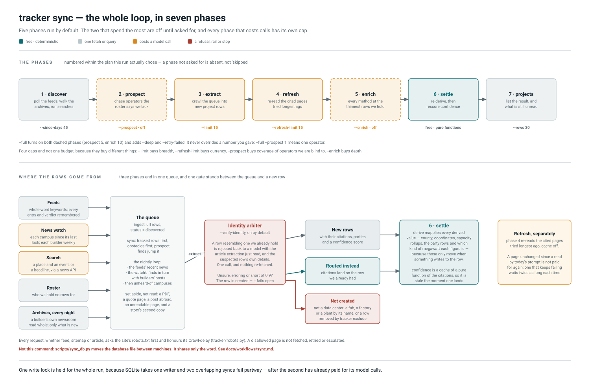

# `tracker sync`

> Everything in one command: find what is missing, read it, settle it, list it.

Seven phases. Five run on a bare `tracker sync`, which is the cheap keep-current
run it has always been; the two that spend the most are off until asked for.

It **writes**, holds one write lock for the whole run, and per `CLAUDE.md` §2 runs
on the production host:

```bash
ssh $PROD 'tracker sync --full'
```

> **Not `scripts/sync_db.py`.** That moves the database *file* between machines and
> shares only the word. It is [below](#the-other-sync).



## The phases

Numbered within the plan *this* run chose. A phase that was not asked for is
absent from the count rather than shown as skipped — "2/7 prospect — skipped" on
every ordinary run would train a reader to ignore the labels, and the point of
numbering a long run is that somebody watching it knows how much is left.

| | Phase | Default | Cap |
| --- | --- | --- | --- |
| 1 | **discover** — poll feeds, walk every archive for what it added, run place-anchored searches | on | `--since-days 45`, `--search` |
| 2 | **prospect** — chase operators the roster says we hold no rows for | **off** | `--prospect N` |
| 3 | **extract** — crawl the queue into new project rows | on | `--limit 15` |
| 4 | **refresh** — re-read the cited articles tried longest ago | on | `--refresh-days 30`, `--refresh-limit 15` |
| 5 | **enrich** — every method at the thinnest rows we hold | **off** | `--enrich N`, `--enrich-budget 60` |
| 6 | **settle** — re-derive, then rescore confidence | on | free |
| 7 | **projects** — list the result, and what is still unread | on | `--rows 30` |

`--full` turns on both optional phases (`prospect 5`, `enrich 10`) and adds
`--deep` and `--retry-failed`. It does **not** override a number you gave:
`--full --prospect 1` means one operator, because a flag that silently discarded
the value beside it would be a trap.

### Four caps, not one budget

They buy different things, and a single budget spread across all four would
silently favour whichever phase ran first.

* `--limit` buys **breadth** — new rows.
* `--refresh-limit` buys **currency** — rows that are still true.
* `--prospect` buys **coverage** of operators we are blind to. Nebius was absent
  from 300 projects and no amount of feed polling was ever going to say so.
* `--enrich` buys **depth** on rows that already exist. Its agent pass — the
  ~77,000-token rung after the harvest — sees only the rows the harvest actually
  reached, as in `tracker enrich`; it was handed every chosen row, so even
  `--enrich-budget 0`, which reaches none, paid for a model call on each. It shares
  enrich's savings: a page unchanged since its last read under the same prompt is
  not sent again (the rule the refresh phase below applies), an article is read for
  the row being enriched only, and a row with no fillable field left empty is not
  chosen. See [enrich](enrich.md#what-a-read-costs-and-what-is-not-read-again).

## Keeping up: what discovery looks at every night

Built on 2026-10-18 after Meta's own post "Kuna, we are online!" (published 09-03)
reached the database on 10-17, by accident. Three things had to change, and the
nightly loop (`scripts/overnight.sh`) now runs all three **first**, before anything
else can crash or spend the night: a host reset at 19:32 on 10-16 came before
discovery, which then ran last, and the day's news was lost.

**The keyword filter matches whole words, and remembers what it drops.** A term in
`[filter]` (`tracker/seed/feeds.toml`) matches whole words, and one ending in `*` the
start of a word: `stock` no longer drops Stockton, `jobs` no longer drops "creating
100 jobs", and `announc*` still catches "announced". A headline that names a tracked
campus is kept even with no keyword (`discover.known_project_test`), unless an
exclusion names it a podcast or a careers page. Every entry a feed or archive shows
is remembered with its verdict in `seen_url` (migration 0039) — queued, already
known, dropped (with the term or the missing tier), or listed — so a miss can be
counted, and `tracker discover --rejudge` puts every drop through a revised filter
and queues what it keeps. Before this, a dropped entry left no trace at all.

**Every archive is walked every night, and only what it added is judged.** The
[[sitemap]] entries used to be walked only by a hand-run `--deep`, last on 09-25,
and through the keyword filter, which dropped every one of Meta's milestone posts
("Hello Tulsa", "Kuna, we are online!", "Montgomery, we're growing"). Now
`discover.watch_newsrooms` walks them all each night and compares what each lists
with what it listed before:

* **An operator's own data-center newsroom is read whole** — an entry with
  `company` and `topic_implied`. Everything new on it is queued with no keyword
  test; only the exclusions still apply, so a careers page stays out. A mixed
  newsroom (about.fb.com, which also announces Instagram features) and a trade
  archive keep the filter.
* **The first walk of an archive is a catch-up, not news.** On an operator's own
  newsroom it queues what passes the filter or names a tracked campus, from every
  year, and records the rest as `listed`; from the second night on, an entry the
  archive did not list before is new. That is what brings in the campuses Meta
  announced and the database never held (Tulsa, Beaver Dam, Bowling Green, Henrico,
  Los Lunas). A third-party archive (a trade site's back catalogue, a directory) was
  swept under the old filter already, so its first walk queues only pages naming a
  tracked campus: rehearsed on a copy of production on 2026-10-18, the broader filter
  would otherwise have queued 1,700 of their old pages, 851 from one directory. The
  first walk of all 28 archives queued 1,106 entries; the second, nothing.
  "First" means most of what the archive lists is unseen, not that its name is new,
  so renaming an entry does not start it over.
* **A surge is a catch-up too.** More than 25 unseen posts on an operator's own
  newsroom in one night (`NEWSROOM_SURGE`) is not what it publishes: it is a child
  sitemap that failed on the first walk, a child newly in reach, or moved URLs. Read
  whole, DataBank's 488-post second sitemap would have taken three nights of reading
  ahead of the news, dated by a site-wide edit. They are judged as on a first walk,
  and the morning report names the archive.
* **So is an entry listed late**: first seen more than 45 days after its own date
  (`LATE_LISTING_DAYS`, wider than a month because a WordPress path dates a post only
  to the first of its month). On the first production walk, 2026-10-19, Utility Dive
  answered six of its monthly child sitemaps with a Cloudflare challenge; the night
  they answer, their 2024 articles are unseen, and judged as news they would have
  been queued as that night's. The morning report names the archive.
* **A post is dated from its address when it can be** (`/2026/09/`), and from the
  sitemap's `lastmod` only when it is new tonight: Meta's 2021 posts carry 2025
  dates, a site-wide edit.
* **Media sitemaps are not walked.** Meta's index names its children `sitemap-1`,
  `image-sitemap-1` and `video-sitemap-1`, none of them a "post" or "news" name, so
  all three were walked and logo attachment pages were queued (`_MEDIA_SITEMAP`).
* **The walk is kept for the rest of the night.** Each sitemap that answered is saved
  in the `sitemaps` cache (`discover.RememberingFetcher`), and a later walk within
  twelve hours (`WALK_FRESH`) — enrich's archive harvest, prospect's sweep — reads
  that copy instead of asking the site again: on 10-19 enrich re-walked all 28
  archives an hour later, 101 requests for the same bytes. A dry run keeps nothing.
  See [enrich](enrich.md#the-six-harvesters).

**Every campus is searched for news, on a schedule.** `tracker news`
(`tracker/ingest/watch.py`) is the per-campus question the research never asked:
*what has been said about this campus since we last looked?* One news search per
campus — its company as the press writes it ("QTS", not "QTS Data Centers"; both
halves of "Amazon (AWS)"; Meta for a row filed as Facebook), and its town, county or
distinctive name — limited to the dates since its last look and sorted newest first
(a page of ten ranked by relevance could be filled by the week's older stories),
daily for a campus being decided or built, every three days once it operates, daily
for any campus of a company a reader watches. "Daily" allows eight hours' slack
(`EARLY`): the watch starts after discovery, whose length varies, and an exact 24
hours skipped every daily campus on a night that began a few seconds early; at six
hours, the first look at every campus, run by hand at 00:11 on 10-19, made them all
due at 18:11, seven minutes after that night's watch began. A look whose search
fails leaves the clock where it was, so the next one reaches back past it. A campus's **first** look reaches back a year,
with a second search for the words its stage is waiting on ("online", "energized",
"delayed" for one under construction); up to `--baselines` campuses get one a
night, largest first, so switching the watch on catches the whole database up in
two nights. A result is queued as `watch:#<id>` when its headline and snippet pass
the filter or name the campus, and its date is in the window. No model is called.

**A campus past its online date is searched for going live before it is called late**
(`watch.golive_query`, `delays.awaiting_search`; `--golive`, 40 a night, most overdue
first, ahead of the follow-ups). The client's rule for a suspected delay is "past its
date, and a search still finds no news of it going live", and the flag used to skip
the search: on 10-22 half of its 14 campuses had simply opened years before without
an article we read (Savvis MP2, 2014; CH3, 2018; NTT Mesa, 2022), because a first
look reaches back only a year. One web search per campus, from 120 days before the
stated date to today, for the words of opening, energising, slipping or stopping;
results are queued as `watch:#<id>` and read that night. The search's time goes on
the row (`project.golive_checked_at`, migration 0047), and `delays.assess` flags a
campus only once a search made after its period ended has run
(`delays.searched_since_due`). A campus whose date slips later needs a new search
once the new date has passed. **A flagged campus is searched again every 30 days**
(`delays.GOLIVE_RECHECK`), after the never-searched ones: searched once, Tesla's Dojo
stayed flagged on a query that could not find its 2025 shutdown, and nothing asked
again. **Only a date a source states in its own words can make a campus late**
(`facts.stated`): on 10-24 five of the ten campuses past their date rested on a
待确认 date or a directory's copy. Four were records to fix -- a directory page's
guess, a month an article never gave, a misread copied by a directory, a 2013
announcement -- and the fifth, DC Blox Conyers, a real slip whose date the reader
had stated without a quote. They are not searched for either; a re-read that quotes
the date brings a real one back. **Each go-live check also re-reads the campus's own
listing pages** when they are more than 30 days old (`watch.relist`,
`watch.LISTING_STALE`): the directory pages it already cites, queued again and read
first beside the search's results. A listing changes with its building, and a
citation keeps what it said on the day it was read: NTT's VA10 page on datacenterHawk
read "under construction" on 09-15 and "Commissioned" by 10-26, while the row stayed
a suspected delay on the old reading. Searches still skip directories: their listings
disagree with the record often enough (one listed DC Blox's first Conyers building as
running in 2025 while the county said in May 2026 it was being built) that only a page
already cited for the campus is read.

**A result no campus story can be in is never queued** (`screen.not_news`, asked in
`watch._screened`): a PDF, a stock-quote or stock-chatter page (Stocktwits, Simply
Wall St, Seeking Alpha and the like; not stocktitan or investing.com's news, which
read and cite), a job posting, a directory's ZIP-code page, a page on a site that has
refused every read (datacenters.com, 0 of 192). By 10-19 the watch had queued 125
such pages, and the 42 tried produced one citation. **Nor is local news about
something else**: a result kept only because it names the campus is dropped when it
reads as a game, an obituary, a killing or a restaurant and carries no data-center
term (`screen.off_topic`). A campus's town and company were in a New Albany football
recap, a taqueria near MIT and a Tesla diner in Palo Alto, and the first look queued
all three.

**Then each company is searched as a company** (`watch.run_companies`), because a
campus search can only find a campus the database already holds: Microsoft buying
land in a county with no Microsoft row is invisible to it. Every company with three
or more campuses here is searched weekly, and one a reader watches daily, for
`"Company" "data center"` since its last search; the first reaches back a month,
since the campus watch's first look already read a year about every campus held.
Results pass the same filter and are queued as `watch:company:<key>`, read in the
watch's turn. About 20 searches a night once the first pass is done.

**Searches have their own cap.** They are prepaid credit, not the model bill, so
the spend ledger records each one (model `serper`) and `TRACKER_SEARCH_CAP` — 2,000
a night from the loop, of which the watch, running first, may use all but 500 —
stops every command at it, the research's searches included. Outside the money
ceiling is not outside the report: the spend report and the news report price them at
about ¥0.007 each (`spend.SEARCH_CNY`, Serper's $50 for 50,000) beside the model spend,
because on 2026-10-19 the night closed on "¥9.89" while its 780 searches had spent
about ¥5.54 more. A search the cap
refuses is not a search that found nothing: the research records no attempt for it. `tracker news report` prints, in the morning, what each source showed,
kept, read, failed to read, set aside unread and changed, how late the news arrived,
and warns when no discovery ran, when a feed's newest entry is over 45 days old, and
when search credit will not last a fortnight.

The failures and the set-asides are counted because the reads alone made a source
look whole. On 2026-10-19 the news watch showed 146 reads and 62 finds and nothing
else, while 115 more of its articles would not load (66 refused with HTTP 403, 32
whose robots.txt did not answer) and 410 left the queue unread — copies of a story
already read or queued, and pages on publishers closed to us.

## What search looks for, and why it is not a model's idea

Search used to ask a model to **name projects** to look for. That can only ever
reach projects somebody already wrote enough about for a model to have learned
them, which are the ones already stored — so the one phase meant to reach past the
configured feeds was pointed at the same ground they cover.

It now names a **place and an event** instead, and needs neither the operator nor
the campus: *"Loudoun County Virginia data center rezoning application"*. A county
votes on a rezoning before anybody announces anything and publishes the agenda
either way, which is how this can surface a site nobody here has heard of.

Both halves are derived rather than written down. The events are a fixed table of
ten, each carrying a term the discovery filter already recognises — a phrase the
filter would reject returns hits that are all discarded before they cost a fetch,
and leaves no queued row to say so. The places come from the database: counties
already holding two or more projects first, because campuses cluster; then states
carrying capacity on thin coverage; then, capped at two slots, states holding
nothing at all.

**A place the filter cannot accept is reported, not skipped.** An `exclude` term
matches whole words anywhere in the haystack, so a place named by one would be
unsearchable for any query. Until 2026-10-18 terms were substrings, and `summit`
(there for conference write-ups) and `stock` (there for finance coverage) made
Summit County and Stockton unsearchable. Left in the plan such a place spends a slot
every run and returns nothing.

**Each run walks the diagonal of the cross product**, preferring pairs that have
never produced anything. Taking the first N in rank order instead would spend a
whole run on one county and re-run the identical queries the following night.

`tracker search --plan 10 --print-only` shows the plan and its labels, costs
nothing and needs no key.

**`--search N` now means N queries.** It used to mean "ask a model for N queries",
while the number actually issued was capped separately inside the run — so
`--search 25` announced 25 and sent 10. The count is capped against
`TRACKER_SEARCH_MAX_QUERIES` before anything is printed, and the printed number is
the number run.

`--from-llm` still exists and still asks a model for project names. It is kept
deliberately: it is the one path that can name an operator in a place holding no
rows, and running both is what lets `tracker queue stats` say which is worth the
quota rather than leaving it asserted.

## A feed that refuses every client is closed, not deleted

On 2026-10-02 thirteen of the 28 feeds — datacenterdynamics, datacenterfrontier and
all eleven States Newsroom sites — and the datacenterfrontier archive answered every
request with a Cloudflare challenge: a page that lets through only a client that runs
the site's own detection script. A browser's User-Agent changes nothing, nor does a
browser's TLS fingerprint, and the article pages answer the same way. Getting past it
would mean passing the publisher's bot detection, which this project does not do, so
a request to any of them can only fail.

Those entries now carry `closed = "<date>: <what was measured>"` in
`tracker/seed/feeds.toml`, beside the measurements:

* **A closed feed is not polled, and a closed archive is not walked** — by
  discover, by `--deep`, or by enrich's archive harvest. The report counts them as
  `feeds closed`, apart from `feeds failed`: thirteen failures a night that everyone
  expects would teach a reader to stop reading that line, and the fourteenth, which
  nobody expected, would go unseen.
* **They stay in the file.** `tracker feeds` proposes publishers whose citations
  decide stored values and that the file does not list. datacenterfrontier decides
  more than any other, so deleting it would put it at the head of that list for
  good; a closed entry still counts as listed.
* **The same rule covers a block that is not a challenge.** globenewswire-data-center
  answered Akamai's "Access Denied" to the feed, its articles and its robots.txt from
  2026-10-10, from the proxy exit and from a second network, and was closed on
  2026-10-13.
* **A challenge is named when one is met.** Cloudflare marks the page
  `cf-mitigated: challenge`, and the failure line says `HTTP 403 (Cloudflare
  challenge: …)` rather than a bare 403, which reads as a header problem and is not.
* **What they queued before the block is taken out of the queue** — 650 rows on
  2026-10-02, 522 of them datacenterfrontier's — because those pages answer the same
  challenge. Only the ones whose syndicated body was cached stay queued; the rest are
  discarded until the publisher reopens; see rule 4 below.

**Each is asked again once a week** (migration 0034, `discover.probe_closed`):
one request to the entry's own URL, with discovery's usual client, from
`tracker discover` — so the nightly loop does it without being told. An entry whose
check comes back as a real feed or sitemap is polled again from that night, and its
pages stop being read last; the first poll that fails closes it again the same
night. The checks are rows in `feed_probe`, not edits to the file, because the
host's checkout is reset to the pushed commit every two minutes. When a reopening
has held, delete the `closed` line. `tracker discover --probe-closed --dry-run`
asks every one now. On 2026-10-07 all fourteen still answered with the challenge,
from two networks and from a browser.

## Headlines from a publisher we cannot read

**The headlines come from a news-search API since 2026-10-11.** They used to come
from Google News's RSS search. When every fetch began asking `robots.txt` first
(`tracker/robots.py`), that stopped: `news.google.com` disallows `/rss/search` for
crawlers. A feed with `news_search = "<query>"` in place of a URL is asked through
Serper's news endpoint instead (`SerperProvider.news`, `discover.search_news`). That
is an API this project pays for, about $0.001 a page of ten, not a page a
`robots.txt` governs. It runs two kinds of query, each limited to the past week (`news_search` and
`web_search`, unioned by `discover.search_news`):

- **The news endpoint, by the publisher's name.** A `site:` query there returns
  profile and directory pages, undated.
- **The web endpoint, with `site:` on the news section** (`SerperProvider.recent`).
  This finds stories the news index skips.

Measured on 2026-10-11: DCD's name gave 15 on-topic headlines in five pages, and
`/en/news` gave 11 in three, with little overlap. DCF was thin in both, with nothing
on topic that week, so it gets one page of each. That comes to about $0.01 a night
before lookups.

A result is kept only when its link is the publisher's own and not under
`/sponsored/` (`discover.news_headlines`). The publisher's studio segments, job
lists and "Global" round-ups are dropped with the surveys and polls. The link is
recorded as the `skipped` headline row, in place of Google's.

A lead's own title must share at least two of the headline's distinctive words
(`TITLE_OVERLAP`), whatever its snippet says. On the first measurement, a page
titled "The WA-AIR Room" matched two unrelated headlines through its snippet alone.
Company-profile stubs (CB Insights, Dealroom and similar) and Muck Rack are never
leads.

Measured end to end that night: 22 on-topic DCD headlines; 20 looked up gave 20
leads, about 15 of them real copies after these rules. If DCD or DCF reopens, its `skipped` headline rows need requeuing, because
they were recorded as headlines and never handed to the crawl.

A `[[feed]]` with `headlines_of = "<site>"` lists another publisher's articles —
Google News's RSS search for datacenterdynamics.com and datacenterfrontier.com, the
two most-cited sources before they closed. Its links lead back to the blocked page,
so nothing from it is queued. A headline has to name the topic itself or state a
capacity ("1GW") — DCD also covers telecom, chips and quantum, and on the first
night 23 of its 39 headlines were those — and the publishers' surveys and polls are
dropped. Then `discover.follow_headlines` looks each remaining headline up once (Serper, about $0.001, at most 40 a run), with every closed
publisher excluded, and queues up to two results that tell the same story — most
of the headline's distinctive words — dated like the headline so the news-first
crawl reads them first. A result whose title repeats the headline word for word is
a reposting site carrying the blocked article, and is skipped: reading it there
would be reading it anyway. The headline itself is stored as a `skipped` row, so
it is looked up once and never handed to the crawl. Measured on 12 DCD headlines
on 2026-10-07: 10 readable copies for 7 stories — PennLive and WJAC on AWS's
Indiana County campus, San José Spotlight on the IBM site, Applied Digital's own
release, and two reposts left out.

Bisnow is the other kind of failure. Its data-center feed went away when the site
was rebuilt — `/rss/data-center` now redirects to a 404 — so that entry was
replaced rather than closed, by `bisnow-latest`: the one feed it still serves, the
nine newest stories across every market.

## Every request asks robots.txt first

The feed client, the article clients and the browser all ask the site's
`robots.txt` before they request a page (`tracker/robots.py`). It is read the RFC 9309
way: a 4xx means no file and nothing disallowed, and a 5xx, a 429 or no answer means
nothing is fetched for half an hour (a 429 the way Google reads it: the site is asking
for fewer requests). A file that was read is kept for a day per process, and **one
reading serves every rung**: the browser kept a stricter one of its own until
2026-10-20, refusing pages on 58 sites whose file answered 403 or 429 on 10-19 that
every other rung, DeepSeek's fetch included, read as allowed. A disallowed page comes
back as a failed fetch with `via = "robots"`, from any rung, and no request is made.
It is not retried and not escalated, because a stronger client would get the same
answer; the browser's refusals used to come back untagged and were retried after a
backoff. `Crawl-delay` stretches the gap between two requests to one host, up to
60 seconds. On 2026-10-11, 43 of the 45 open feeds and sitemaps were permitted; the
two refused were the Google News headline feeds above, which now come from a news
API instead.

## Where the queued rows come from

Three phases end in the same queue and answer different questions. Discover and
search ask *what is being published*; prospect asks *who are we blind to*, which is
a question only the roster can pose. Prospect runs **before** extract so its finds
are eligible for this run's crawl rather than the next one.

The queue is ordered **before** `--limit` bites, never after — truncating first and
prioritising after would reorder a batch that was already chosen:

1. Candidates covering a project we already track go first (`known_first`). A
   queued article about a tracked project becomes a *second* source, which fills
   fields one article cannot and lifts confidence from 2 to 3. Draining oldest-first
   instead just grows the database sideways with more single-source rows.
   `--breadth-first` opts out.
2. Among those, the ones reporting an obstacle. A press release never names its own
   blocker, so those are the only calls that can record one at all.
3. Prospect's finds jump the whole queue. `known_first` sorts by "covers a project
   we already track", which an article about an operator we have **no** rows for can
   never satisfy — so left to the ordinary ordering it sits behind a permanent
   supply of better candidates and is never read.
4. **A page nothing can read leaves the queue.** A publisher marked `closed`
   answers every client with a challenge, its articles included, so a page on one
   can only fail unless its body was cached before the block. On 2026-10-02, 628 of
   the 2,287 queued articles were such pages, and they held six of the nightly
   crawl's next ten slots and all fifteen of a sync extract, because
   datacenterfrontier and datacenterdynamics both rank `priority`. Moving them behind
   every readable page fixed the slots but left them queued for good — 627 of 1,893
   on 2026-10-14, inflating every queue count. So before the queue is read, each one
   becomes `skipped` with the reason `discover.DISCARDED_UNREADABLE`
   (`discover.discard_unreadable`). That is not final: when the weekly check finds a
   publisher open again (feed and archive both), its discarded pages go back in the
   queue (`discover.requeue_reopened`), and a page skipped for any other reason
   stays skipped.
5. **A page no campus story can be in is set aside before it is read**
   (`discover.set_aside_not_news`, the rules in `tracker/ingest/screen.py`). By its
   address: a PDF, which nothing here takes text from — the plain client handed the
   model its compressed bytes, and of 384 PDFs read since August none produced a
   citation; since 2026-10-20 a fetch that gets a file back, by whatever address,
   fails as one (`fetch.file_type`) rather than becoming text for the model; a
   translated copy (Google's campus pages in twelve translations, 114 of
   its 166 queued); a stock-quote or stock-chatter page; a job posting; a
   directory's ZIP-code page; a site that has refused every read. From a builder's
   own archive, also by its headline: a post naming a place abroad and none here
   (CyrusOne's Frankfurt, Cologix's Toronto, Google's Hamina — a campus abroad cannot
   become a row), and a post from before 2024 that names no place and no campus
   event (an award, an Earth Day post). On 2026-10-19 that is 284 of the 5,924
   queued pages; run against that night's 594 reads it would have set aside 76, of
   which one had produced a citation. **Each rule is narrower than first asked for,
   because the wider one cost campuses**: old builder posts naming a town brought in
   Henrico, Los Lunas and Umatilla, so they are read; a directory's county and state
   pages produced a citation as often as the night's average, so only its ZIP-code
   pages go. Set aside is `skipped` with `screen.SET_ASIDE` and the reason, and every
   such page is asked again on each run: one no rule names any more — reading PDFs
   one day, a campus newly held — goes back in the queue. It runs before the next
   rule, so a page that will never be read is not kept as a story's one copy.
   `tracker queue aside` shows what would go.
6. **One copy of a story is read.** An article can be queued more than once under
   different addresses: CyrusOne files every release under two paths, a story is
   syndicated to three sites, a search engine cuts a headline short, a page was
   already read through another outlet's copy. On 2026-10-19, after the news watch's
   first look, 159 of 6,646 queued articles were such copies (2.4%): 53 the same
   headline on another site, 45 a headline cut short, 42 the same headline twice on
   one site, 19 the same page under another address. Before the queue is read, each
   becomes `skipped` with `discover.SAME_STORY` and the address of the copy kept
   (`discover.drop_same_story`). Two headlines are one story when they are equal —
   six words or more on one site, eight across two, since short ones collide by
   accident — or when one cut short ("...") is how the other begins; a headline only
   longer than another is not taken for a copy. The copy kept is one already read,
   else a readable one, with its full headline, queued first. If the copy kept fails
   or comes back thin, the others go back in the queue the next night: a paywall on
   the first site is not a reason to lose the story. `tracker queue duplicates`
   shows what would go.
7. **With `--screen`, a model reads the headlines before the pages are**
   (`tracker/ingest/headlines.py`). Rule 5 judges a page by its form; this judges it by
   what its headline says. A call with no reasoning reads fifty headlines at a time
   and names the ones that are plainly a place abroad, a hire or award, an event, market
   commentary, a product, or nothing to do with data centers; every other page is read,
   and a page is kept whenever the model is unsure or the call fails. About half of all
   reads find no campus (2,235 of the 4,642 with a headline settled by 2026-10-26), and
   each costs a full extraction to learn what its headline already said. The screen asks
   only about the pages the crawl is about to read, and replaces each one it sets aside
   from further down the queue, so `--limit 900` still reads 900. Go-live results for a
   campus past its date are read whatever they say. A page set aside is `skipped` with
   `headlines.ASIDE` and the kind; a page kept is stamped with the prompt's version and
   not asked again, because each asking is another chance to lose it.
   **It is off until measured**: `tracker queue screen --measure` puts the headlines of
   pages already read through it and lists every read that found a campus it would have
   set aside, and the nightly loop runs it only with `--screen`. `tracker queue screen
   --undo` puts back everything it set aside.

**Whatever the order, news of a campus past its date is read first**
(`discover.deciding`): the news watch's finds about a campus that is late by the
record. The console flags such a campus as a suspected delay once its go-live search
has run, and the search only queues what it found, so until those results are read a
campus can be flagged with its opening sitting unread in the queue. That happened to
all 13 campuses the first searches covered on 2026-10-22: 19 results queued, a crawl
in the backlog's order read one. They are a few dozen a night at most.

`ingest crawl --from-queue --new-first` asks a different question, and is what the
nightly loop's discovery step runs. **The news goes first:** every article the
feeds and archives offered that was published within the email's window
(`feed.REPORT_WINDOW_DAYS`, 60 days), newest first,
whatever campus it names, because what the crawl reads tonight is mailed tomorrow. A
2026-09-21 report of a lawsuit against a *tracked* campus used to sort behind 1,600
backlog articles; it was read on 10-03 and mailed on 10-04 as news. **Then what was
looked for on purpose**, the two taking turns, each newest first: the news watch's
results, whatever their date (last night's follow-ups lead its share), and a
builder's own posts — those its newsroom added since the night before
(`seen_url.reason` = `NEWSROOM_NEW`) and those about a campus the database does not
hold, which is how a campus Meta announced and the database never had comes in. An
old `--deep` sweep's builder rows about tracked campuses stay in the backlog. The
watch's results are about a campus by construction, so the next rule would put them
last, and its first look finds news older than the window; the turns are because that
first look queued about 5,000 results on 2026-10-19, about 350 inside the window.
Counted as news, those took every one of the first 400 reads after the feeds' 124,
and read one after the other the rest would have kept the 703 builder posts about
unknown campuses waiting two weeks. Then
the articles naming **no** tracked campus, newest published first, then
the rest — rule 4 applying throughout. A date more than a day in the future is no
date: an event page dated 2026-12-01 led the order on 2026-10-17. **The news group
is read in turn across its sources** (`discover.in_turn`), newest first within each:
a directory re-dated 60 pages in one site-wide edit on 10-14 and, read newest first,
they took 60 of the night's first reads. Enrich reads for
one row and creates none, so that step is the loop's only source of new campuses;
each article still goes through the identity arbiter below before it can insert a
row. The same rule orders `--retry-failed`'s fill, the refresh phase below, and
each round of [enrich](enrich.md#what-a-read-costs-and-what-is-not-read-again).

Publishers that `tracker/seed/sources.toml` ignores are partitioned out and **named**, not
merely subtracted: the queue still holds those rows and `tracker queue` still lists
them, so the number has to be attributable.

**A page is queued once, whatever its spelling.** Tracking parameters — Google's
`srsltid` rides on every search hit — are dropped before a URL is stored, and a
candidate is already known when another spelling of it (`www.`, a trailing slash,
`http`) is. The same identity keys a project's citations, so one article cannot be
cited twice: 19 projects on a copy of production did, and 69 queued URLs had a
second spelling already in the table.

Prevention does not reach rows already stored, so `tracker backfill urls` repairs
them — a preview, and `--apply` to write. A row's extra copies of one article are
folded into its earliest by the rule `tracker merge` applies to a shared citation
(what only a copy said is carried, a rival figure is named, milestones and
obstacles move with it), and an article a citation shows was read leaves the retry
pool its failed re-read had put it in. On the snapshot: 23 extra citations on 17
rows, one of them the same report five times, and 36 read articles, with no
figure moving. A second pass finds nothing.

**A page not in English is refused before extraction.** Search already dropped
non-English hits by their title and snippet; a feed or an archive had no such
test, and a translated repost is read for its identity, which is the part that
comes back wrong. Of 70 stored citations from Chinese-language pages, 68 carried a
"confirmed" city — "孟菲斯" for Memphis, "Salien" for Saline — and seven rows
rested on nothing else, each a garbled duplicate of a campus held under its
English name. `crawl.extract_one` marks such a page `skipped` before the call, the
run summary counts it as "not in English", and it is not retried.

**A project the reading names without a company, a US state or a place is dropped,
and counted.** Each is logged ("dropping a project from …: needs company, state and
a locality"), and since 2026-10-20 the run summary also counts them as "dropped: no
company, state or place" (`IngestReport.incomplete`): 73 on the night of 10-19, 61
in its main crawl — a county debating a moratorium with no company named, a
company's plans with no town, a campus abroad (Odense, Luleå, Frankfurt, Toronto). It
is the measure of what the model was asked to read that could not become a row.

**A new project that is not a data center is not created, and counted.** A reading
sometimes names a facility of another kind beside the campuses it is about: one
round-up of "products for data centers" gave the database a Ford battery plant, a
Corning cable plant and a Siemens switchgear plant, and SpaceX's chip fab and Crusoe's
factory for modular data centers came the same way — about $19.5 billion of the
investment total and no megawatts, until they were removed on 2026-10-20. Since then
the write step creates no row whose name says fab, foundry, factory, manufacturing or
plant with no data-center word beside it ("Nebius AI Factory", a "data campus" at a
generating station and "Imperial Valley Computer Manufacturing" are created as
before), and none under an identity `tracker exclude` removed — the key the row was
born with, the one it would be born with today, its aliases, and its county's key
when it also had a town. The summary counts both as "dropped: not a data center".
Only an insert is ever refused: a row that exists keeps receiving its news. Checked
against all 721 production rows, the name rule named those five and nothing else. A
real campus the same company later builds in the same town would be refused too,
which is what `tracker exclude --lift <id>` is for; `--list` shows every excluded key.

**A write that would break a held relationship is refused, one record at a time.**
Running never above planned, a campus's capacity lines adding up to it, what it
delivers never above its total (`tracker/invariants.py`, the `held` kind) are
guaranteed by the merge code, so a record whose write would break one is a bug, not
a fact. The last thing `upsert_record` does is check them (`invariants.enforce`,
which raises `HeldBroken`); the crawl rolls back that record alone — the article's
earlier records are already committed — counts it as "refused: would break a held
relationship", logs the campus and the relationship, and leaves the URL as read but
not written, so the next read after the fix writes it. On production on 2026-10-22
no campus broke any held relationship, so nothing a crawl wrote that night would
have been refused.

**Quoted money that is not spending on the site is marked, not stored as fact.** An
analyst's extrapolation ("an extrapolated total capital expenditure … potentially
ranging from $8.3 billion"), a directory's own projection ("we project … a capital
cost of $8.1 B") and a customer contract's value ("a $9.7 billion AI cloud agreement
with Microsoft") all passed the quote check on 2026-10-21 and became campus
investment. `crawl.money_kind` reads the verified sentence for the claimed figure and
marks it 待确认 `speculative` or `contract_value`; Capex leaves both out, like a
programme total. "Could reach" and "could top" are not enough — that is how ordinary
planned budgets are reported — and the hedge must be on the figure claimed. The same
rule re-runs over stored claims every night in `backfill scope`.

**A month the model wrote as 1 January takes the sentence's month.** The prompt asks
for a bare year as `YYYY-01-01`, and the model sometimes does that for a month too:
"completion projected in December of 2021" came back 2021-01-01 and was labelled
year-precise. `normalize.month_named_in_quote` corrects it after the evidence gate,
and `backfill precision` corrects stored claims; "December of 2021" now also reads as
a month.

**A citation is dated by its article, not by when the watch found it.** The news
watch dates a URL by its search hit, and the page's own date, learned on reading it,
replaces that on the queue row. A citation written in between kept the sighting —
DCK's 2017 Digital Realty article read as 2026-10-12 and won a capacity field on
recency. A citation now takes the earliest date known for its URL, never a later one,
on every write and in `backfill dates`.

## The identity arbiter

`--verify-identity` is on by default. Before a phase creates a row that has a
near-match, one model reads the arriving article and says whether it is the same
site — preventing the duplicate rather than reporting it afterwards.

**It judges from the article extraction already read.** The proposed row is rejected
back to a model with everything needed in one turn: the article as the extractor saw
it, the row we think it duplicates (name, company, locality, phase, capacity and its
citations), and which of `_find_duplicate_candidate`'s three branches matched. It
answers `same_site`, `different_site` or `unsure`, and nothing else.

That is one call. The older path needed three or four, because its instructions began
by telling the model to `read_article` the arriving URL — re-fetching, over a corpus
where that answers 403 often enough to matter, the article that had just been read.
Extraction and adjudication stay different steps on different model tiers, which is
right; what crosses between them is the evidence, not a conversation. The cold path
remains for callers with no extraction context and for providers with no multi-turn
call.

**It is asked the same question as the two pair judges.** `triage.CONTRADICTIONS` is
one checklist shared verbatim by all three, so the judgement made at ingest and the
judgement made a week later on the stored rows cannot drift apart; a test pins the
copies together. It asks what would rule the match out, not whether the rows look
alike, and it reports what it checked alongside its verdict — that list is written
into the row's notes with the routing decision. See
[duplicates](duplicates.md#which-judge).

**It fails open, always.** Unsure, erroring, or short of the 0.9 floor and the row
is created exactly as it would have been. The worst case is the status quo, which
is what makes it safe to leave on. The floor is deliberately higher than the 0.85 a
*merge* of two stored rows needs: a merge is reviewed against two full rows of
citations, while this is decided from one arriving article.

**A `same_site` must quote the article**, and the quote is checked against the text
the model was *shown* rather than the full stored article. Extraction truncates —
head, marker, tail — so verifying against the whole thing would pass a sentence from
the omitted middle and leave a gate that proves nothing.

**It never runs inside an open write.** SQLite takes one writer and the console's
sign-in waits five seconds for it, so each record's writes are committed before the
next record is upserted — the arbiter used to be asked about an article's second
project with the first project's writes still holding the lock, for the length of a
model call. **A `--dry-run` does not ask it at all**: a verdict nothing is written
for is a cost with nothing to show, so the dry run counts the insert the arbiter
might have prevented. A dry run also rolls each article back as it goes rather than
holding one transaction from the first URL to the last.

It is passed to both the extract and refresh phases through one helper
(`_identity_arbiter`), so the two cannot drift into different rules about when a
row may be created. Refresh re-reads URLs already attached, so it matches by key
and the arbiter almost never fires there — but `force=True` means that path *can*
still create a row, and a duplicate born in refresh would be no cheaper than one
born in extract.

**A route it makes is remembered.** The arriving key is recorded in
`project_alias` against the row it was routed to, exactly as a merge records a
folded key, so the next article spelled that way finds the row by key and nothing is
asked twice. Until 2026-10-20 a route was only a note: on 10-19 the arbiter routed
`poolside ai` to its row at insert, and two hours later enrich refused an article
about the same campus because that key still matched nothing. See
[duplicates](duplicates.md#every-name-a-campus-goes-by) for the other keys a row is
kept reachable by.

See [duplicates](duplicates.md) for what the same judgement costs once the row
exists: 47 stored groups took a ten-hour agent run.

## What the refresh phase re-reads

The cited articles **tried longest ago**, by `ingest_url.last_tried_at` — falling
back to the citation's own `fetched_at` for a URL no crawl has recorded. It used to
be the URL with the oldest *citation row*, which only a successful write of every
row citing it ever moves: a re-read that failed, or that refreshed two of the six
rows citing a page, left that URL at the head for good. Measured on a copy of
production, the fifteen URLs the phase took every run were 11 `llm_error`, 3
`fetch_error` and 1 `ok`, tried 4 to 24 times each, and the other 1,945 stale URLs
were never reached. Any try now moves the URL to the back.

* **A URL that keeps failing waits longer each time.** Each failed re-read in a row
  doubles its interval (`ingest_url.failures`), up to sixteen intervals, so a page
  behind a WAF the ladder cannot clear stops costing a try every run without being
  given up on.
* **A page on a closed publisher goes last.** The backoff would retire one after a
  few failed runs, but each of those runs spends a slot on it, and the publishers
  closed on 2026-10-02 include the most-cited one in the database. The refresh reads
  past the cache on purpose (below), so here every such page counts as unreadable.
* **A failed re-read does not unread the URL.** It keeps the `ok` its good read
  earned — the citations still stand — and records the failure beside it. Demoting
  it had put 35 cited URLs into the pool `--retry-failed` works.
* **An unchanged page is not paid for twice.** When a page hashes the same as its
  last good read, and every citation that read produced carries today's prompt
  stamp, the model is not asked again (`crawl.run(skip_unchanged=True)`); the URL is
  recorded as tried and counted as `page unchanged, not re-read`.
* **Only what an article reading produced.** `derived:` and `inferred:` citations
  were computed, not read — the Census reference file behind 365 derived citations
  sat at the head of the old order and was fetched and sent through extraction on
  every run — and an ISO queue row's URL is the queue's listing page.

## Two deliberate cache decisions

* **Discover writes into the cache the extract phase reads.** Feeds that syndicate
  the whole article put it there, so phase 3 never requests a page that would
  answer 403.
* **Refresh passes `cache_dir=None`.** The point of refreshing is finding out
  whether the article changed, and serving it from the local cache would guarantee
  the answer is no.

## The settle phase

Two recomputations, both pure functions of what the rows now cite, and both wrong
to skip after a phase that added sources:

* `derive` reapplies every derived value — county, coordinates, capacity rollups —
  because those are only recomputed when something writes to the row. A whole-table
  run first records every row's current natural key (`tracker.keys.sync`), so a row
  whose identity has moved since its birth, or a spelling the company rules have
  learned since, still reaches it — and brings the company registry up to date
  (`companies.sync`, migration 0043): one record per company, its chosen name, and
  every campus and party pointed at it. A row's parties are rebuilt one per company:
  a name listing companies the registry knows ("Oracle, OpenAI") becomes each of
  them, and two spellings of one company in one role ("DPR", "DPR Construction") one
  party (`parties.parties_by_key`). Each row it re-derives also rebuilds that
  row's statements (`facts.rebuild`, migration 0045), the one table every source's
  claims sit in — and the one the project page, the API and the export read each
  figure's evidence from — so neither the page nor the download lags the sources. A
  re-derived row that breaks a
  held relationship is logged as a bug (`invariants.campus_breaks`), not refused: its
  sources have not changed, and the row is already published.
* `recompute_confidence` runs because confidence is a cache of a function of the
  citations, so it is stale the moment a citation lands. It runs even when
  `--skip-derive` declined the first half.

## What the summary always says

Unread URLs are invisible to both `discover` (which never re-queues a known URL)
and the pending queue, so without an explicit line a run would report "queue empty,
0 failed" while articles pile up. The count is reported whether or not *this* run
retried them.

**`--retry-failed` stops at three identical failures.** A URL that has failed the
same way three tries running (`discover.MAX_SAME_FAILURES`) is left out of the
retry and named in the summary instead: a transient failure rarely repeats
identically on three separate runs, and a structural one repeats every time.
Measured on a copy of production, 9 URLs failing "reply truncated" had been tried 66
times and 14 failing with one SSL error 190 times. The same test governs enrich's
retry harvester and the queued leads `--prospect` hands the crawl. `tracker ingest
crawl --url` still reads one, and the retry after a starved reply no longer doubles
past the configured token ceiling. Coverage of operators we should hold is likewise a separate question
a clean sync cannot see, so a run without `--prospect` points at `tracker coverage`.

## The other sync

`scripts/sync_db.py` is a different tool with a colliding name: it moves the
whole database file between this machine and the production host. Reads run
anywhere; **the host is the writer**, so the default direction is *pull*.

```bash
python scripts/sync_db.py            # pull the authoritative database down here
python scripts/sync_db.py --push     # only to seed or restore a host
```

Both directions **refuse when the destination holds rows the source does not**,
which is what losing an ingest looks like from the other end. `--force` overrides
it deliberately; `--dry-run` checks and changes nothing.

Neither direction copies the file. SQLite runs in WAL mode, so committed data sits
in `tracker.db-wal` until a checkpoint folds it back: copying `tracker.db` alone
yields a file that opens cleanly and is silently out of date — 16.3 MB of main file
against a 7.9 MB WAL, measured. `VACUUM INTO` asks SQLite for a consistent
single-file snapshot instead, run on whichever machine is the source, then
`pragma integrity_check` and a row-count comparison verify it *before* it replaces
anything. A pull also unlinks the old `-wal` and `-shm` siblings, which describe a
database that no longer exists here.

Row counts are compared over ssh rather than by fetching 16 MB. The table names are
singular, and getting that wrong is silent — an earlier version counted
`projects`/`sources`, nothing matched, and the snapshot was reported "verified"
having checked nothing. Both directions now refuse outright when no table is
recognised.

## Source map

Touching any of these means the poster is in scope. Re-render with
`python scripts/render_workflow_diagrams.py sync`.

| Concern | Where |
| --- | --- |
| Phase order, plan numbering, `--full`, the lock | `tracker/cli/sync.py` — `sync`, its `plan` list and `step` |
| Discover, archives, search | `tracker/ingest/discover.py` — `run`, `load_config`, `load_sitemaps`, `sweep_sitemaps`, `walk_sitemap`, `index_children`, `_MEDIA_SITEMAP`, `parse_feed` (newest `lastmod` first), `queue_candidates`; `tracker/ingest/search.py`; `tracker/normalize.py` — `canonical_url`, `url_identity`, `url_variants`; `tracker/backfill.py` — `repair_urls` |
| The keyword filter, and what it dropped | `tracker/seed/feeds.toml` — `[filter]`; `tests/fixtures/keyword_cases.json`; `tracker/ingest/discover.py` — `normalize_haystack`, `_SEPARATORS`, `_term_pattern`, `_term_regex`, `_tier`, `_TERM_START`, `term_in`, `first_term`, `_terms`, `FilterSpec.matches`, `judge_candidates`, `known_project_test`, `_GENERIC_NAME_TOKENS`, `_company_words`, `record_seen`, `rejudge`, `TOO_OLD`; `tracker/dedup.py` — `company_aliases`; `tracker/ingest/wiki.py` — `_keyword_pass`, `_substantive`; migration `0039_news_watch` (`seen_url`); `tracker/cli/sync.py` — `discover --rejudge` |
| Archives every night | `tracker/ingest/discover.py` — `watch_newsrooms`, `NEWSROOM_SURGE`, `LATE_LISTING_DAYS`, `NEWSROOM_NEW`, `_month_from_path`, `_absolute`, `run(sitemaps=)`, `RememberingFetcher`, `RecentWalkFetcher`, `walk_cache`, `WALK_FRESH`; `tracker/ingest/enrich.py` — `sweep_archives`; `tracker/ingest/fetch.py` — `date_from_url`; `tracker/normalize.py` — `url_variants`; `tracker/cli/sync.py` — `discover --archives` |
| The news watch | `tracker/ingest/watch.py` — `run`, `golive_query`, `relist`, `LISTING_STALE`, `GOLIVE_PER_RUN`, `GOLIVE_LEAD`, `GOLIVE_WORDS`, `due`, `cadence`, `EARLY`, `plan_queries`, `anchor`, `_company_term`, `_places`, `_names`, `_VAGUE`, `window_for`, `_screened`, `judge`, `CADENCE`, `NEXT_WORDS`, `BASELINE_PER_RUN`; the company watch — `run_companies`, `companies_due`, `company_query`, `judge_company`, `COMPANY_MIN_CAMPUSES`, `COMPANY_CADENCE`; migrations `0039_news_watch` (`news_watch`), `0040_company_watch`, `0047_golive_check`; `tracker/delays.py` — `awaiting_search`, `GOLIVE_RECHECK`, `searched_since_due`; `tracker/cli/sync.py` — `news`; `tracker/ingest/crawl.py` — `record_url` (a watch row's date gives way to the page's) |
| A search the cap refused | `tracker/agent.py` — `SEARCH_REFUSED`, `_search_web`; `tracker/gapfill.py` — `fill` |
| Searches counted and capped; the morning report | `tracker/ingest/search.py` — `SerperProvider._spend_one`, `_post`; `tracker/llm.py` — `record_search`; `tracker/spend.py` — `searches`, `SEARCH_MODEL`, `SEARCH_CNY`, `FETCH_CNY`, `report`, `summary`; `tracker/config.py` — `search_cap`; `tracker/ingest/desk.py` — `build`, `Desk.lines`, `FAILED`, `SET_ASIDE`, `serper_credit`; `tracker/cli/sync.py` — `news report`; `scripts/overnight.sh` — the news phase |
| Closed feeds, and naming a challenge | `tracker/seed/feeds.toml` — `closed`; `tracker/ingest/discover.py` — `FeedSpec.closed`, `SitemapSpec.closed`, `_closed_reason`, `DiscoverReport.closed`, `_RawFetcher`, `CHALLENGE_NOTE`; `tracker/ingest/probe.py` — `configured_hosts` |
| The weekly check of closed entries | `tracker/ingest/discover.py` — `probe_closed`, `record_probe`, `reopened_names`, `without_reopened`, `PROBE_EVERY`; migration `0034_feed_probe`; `tracker/cli/sync.py` — `discover --probe-closed` |
| Asking robots.txt before every request | `tracker/robots.py` — `allowed`, `allowed_async`, `interpret`, `crawl_delay`; `tracker/ingest/fetch.py` — `permitted`, `refused`, `PlaywrightFetcher.permitted`, `fetch_with_retry`, `should_escalate`, `fetch_all`; `tracker/ingest/discover.py` — `_RawFetcher`; `tracker/config.py` — `respect_robots` |
| Headlines-only feeds | `tracker/seed/feeds.toml` — `headlines_of`, `news_search`, `news_pages`; `tracker/ingest/search.py` — `SerperProvider.news`; `tracker/ingest/discover.py` — `news_headlines`, `search_news`, `_poll_news`, `_news_date`, `parse_headlines`, `follow_headlines`, `same_story`, `copies_headline`, `MAX_HEADLINE_LOOKUPS` |
| A page no campus story can be in is set aside | `tracker/ingest/screen.py` — `not_news`, `file_kind`, `translation`, `site_kind`, `_NOT_NEWS_HOSTS`, `_QUOTE_PAGES`, `_LISTINGS`, `builder_aside`, `abroad`, `us_places`, `post_year`, `_CAMPUS_EVENT`, `off_topic`, `SET_ASIDE`, `summary`; `tracker/ingest/discover.py` — `set_aside_not_news`; `tracker/ingest/watch.py` — `_screened`, `judge`; `tracker/cli/ingest.py` — `crawl --from-queue`; `tracker/cli/sync.py` — `sync` (extract); `tracker/cli/queue.py` — `queue aside` |
| A page set aside by its headline (`--screen`) | `tracker/ingest/headlines.py` — `KINDS`, `SYSTEM`, `STAMP`, `ASIDE`, `BATCH`, `judge`, `screen_queue`, `measure`; `tracker/cli/ingest.py` — `crawl --from-queue --screen`, `_screen_headlines`; `tracker/cli/queue.py` — `queue screen`; `scripts/overnight.sh` — `SCREEN` |
| A story's second copy is set aside | `tracker/ingest/discover.py` — `drop_same_story`, `SAME_STORY`, `SAME_STORY_WORDS`, `SAME_STORY_WORDS_ACROSS_SITES`, `_headline`, `_page_key`; `tracker/cli/ingest.py` — `crawl --from-queue`; `tracker/cli/sync.py` — `sync` (extract); `tracker/cli/queue.py` — `queue duplicates` |
| Pages nothing can read leave the queue, or go last | `tracker/ingest/discover.py` — `closed_domains`, `unreadable_test`, `discard_unreadable`, `requeue_reopened`, `DISCARDED_UNREADABLE`, `readable_first`, `pending(unreadable=)`, `retryable(unreadable=)`; `tracker/ingest/crawl.py` — `stale_sources(unreadable=)`; `tracker/cli/sync.py` — `sync` (extract, retry fill, refresh); `tracker/cli/ingest.py` — `crawl --from-queue`; `tracker/ingest/enrich.py` — `run` |
| What search looks for | `tracker/ingest/search.py` — `_PLACE_TEMPLATES`, `rank_places`, `plan_queries`, `PlannedQuery.label`, `templates`; `tracker/normalize.py` — `state_name` |
| Judging a template | `tracker/funnel.py` — `feed_group`, `survey`, `verdicts`; `tracker/ingest/search.py` — `LabelStat` |
| Queue ordering and counts | `tracker/ingest/discover.py` — `deciding` (a late campus's watch finds, ahead of every order), `pending` (`known_first`, `new_first`; news first by `feed.REPORT_WINDOW_DAYS`, read in turn across sources by `in_turn` and `_source_of`, then the watch's finds in turn with builders' posts, a future date as none), `pending_split`, `pending_risk_count`, `failed`, `retryable`, `given_up`, `MAX_SAME_FAILURES`, `failure_summary` |
| Prospect | `tracker/prospect.py`; `tracker/roster.py` — `hunt_order`, `measure` |
| Extract and refresh | `tracker/ingest/crawl.py` — `run` (`origins=`), `stale_sources`, `unchanged_reads`, `record_url` (`origin=`), `_origin`, `failure_reason`, `MAX_REFRESH_BACKOFF`, `build_records(placeless=)`; `tracker/ingest/records.py` — `IngestReport.incomplete`, `IngestReport.not_a_data_center` |
| A write that breaks a held relationship | `tracker/upsert.py` — `upsert_record` (end), `recompute_from_sources` (end, logs only); `tracker/invariants.py` — `enforce`, `HeldBroken`, `campus_breaks`, `HELD`; `tracker/ingest/crawl.py` — `run` (rolls back one record); `tracker/ingest/records.py` — `IngestReport.held_refused` |
| Not a data center | `tracker/upsert.py` — `upsert_record` (`action="excluded"`); `tracker/exclude.py` — `barred`, `not_a_data_center`, `excluded`, `exclude`, `keys_of`, `lift`; `tracker/cli/duplicates.py` — `exclude`; `tracker/migrations/0041_excluded_key.sql` |
| The party gate | `tracker/ingest/crawl.py` — `_parties`, `_ROLE_MARKERS`, `_role_is_licensed` |
| Identity arbiter | `tracker/upsert.py` — `upsert_record` (a route is remembered through `tracker/keys.py` — `remember`); `tracker/cli/ingest.py` — `_identity_arbiter`, `_report_arbiter`; `tracker/gatekeeper.py` — `same_site_arbiter`, `_warm_verdict`, `_cold_verdict`, `_rejection`, `_suspicion`, `_verdict_tools`, `RULES`, `MIN_CONFIDENCE`; `tracker/triage.py` — `CONTRADICTIONS`; `tracker/ingest/crawl.py` — `ExtractionContext` |
| Enrich phase | `tracker/ingest/enrich.py` — `select_projects`, `run_many`; `tracker/cli/enrich.py` — `_gapfill_batch`; and [enrich](enrich.md) |
| Settle | `tracker/derive.py` — `run`; `tracker/keys.py` — `sync`; `tracker/companies.py` — `sync`, `attach`; `tracker/facts.py` — `rebuild`; `tracker/upsert.py` — `recompute_confidence`, `recompute_parties`, `apply_mw_basis` |
| Parties, and what fills them without a crawl | `tracker/parties.py` — `rebuild` (copies an ended role from `party_tenure`, migration 0044), `reconcile`, `parties_by_key`, `_inferred_parties`, `split_names`, `same_company_names`, `known_keys` |
| Which kind of megawatt a figure is | `tracker/ingest/crawl.py` — `axis_gate`, `_BASIS_MARKERS`; `tracker/vocab.py` — `basis_from_quote`, `BASIS_WINDOW`; `tracker/backfill.py` — `derive_basis`; `tracker/gapfill.py` — `_fact_axes` |
| Money that is not spending on the site | `tracker/ingest/crawl.py` — `money_kind`, `_SPECULATIVE_MONEY`, `_CONTRACT_MONEY`; `tracker/backfill.py` — `regate_scope`, `_regate_money`; `tracker/capex.py` — `_demoted_investment` |
| A citation's date: the article's, never the watch's sighting | `tracker/upsert.py` — `upsert_record` (`_published_at`); `tracker/dates.py` — `_propagate`; `tracker/ingest/crawl.py` — `record_url` |
| A month the model wrote as 1 January | `tracker/normalize.py` — `month_named_in_quote`, `_MONTH_THEN_YEAR`; `tracker/ingest/crawl.py` — after `evidence_gate`; `tracker/backfill.py` — `derive_date_precision` |
| Whether a figure is one building's | `tracker/ingest/crawl.py` — `axis_gate`; `tracker/vocab.py` — `part_from_quote`, `PART_FIELDS`, `PART_WINDOW`, `INITIAL_WINDOW`; `tracker/backfill.py` — `regate_scope`; `tracker/upsert.py` — `contenders`; `tracker/gapfill.py` — `_fact_axes` |
| Source ignore list | `tracker/policy.py` — `load`, `partition` |
| The database mover | `scripts/sync_db.py` — `pull`, `push`, `snapshot`, `verify`, `_COUNTED` |
